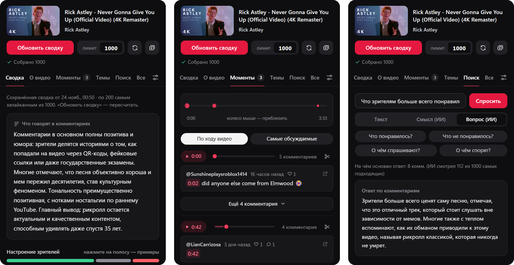
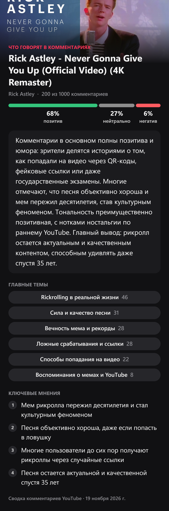
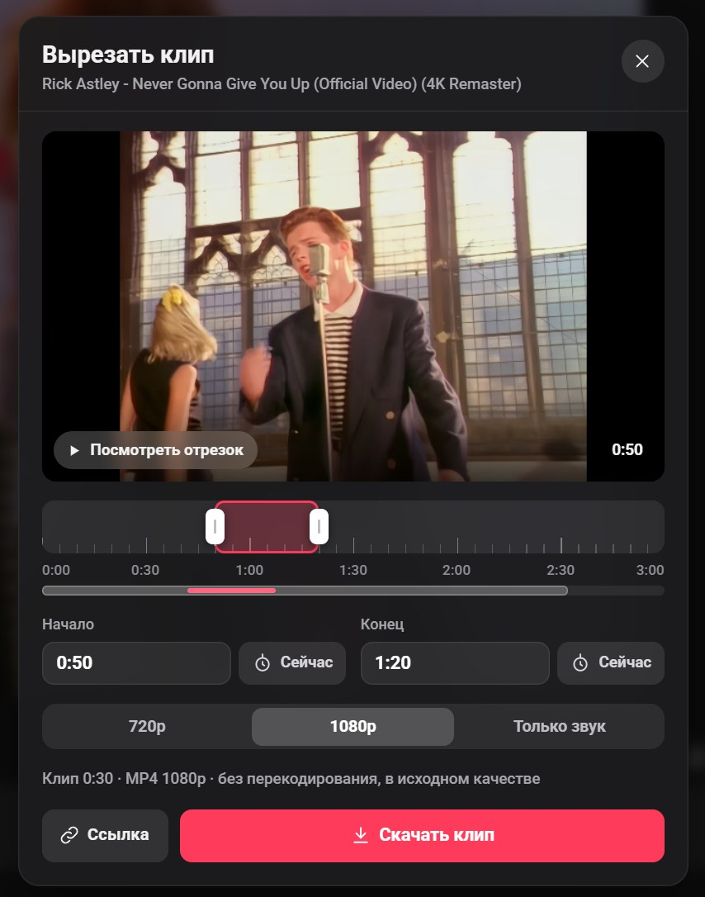
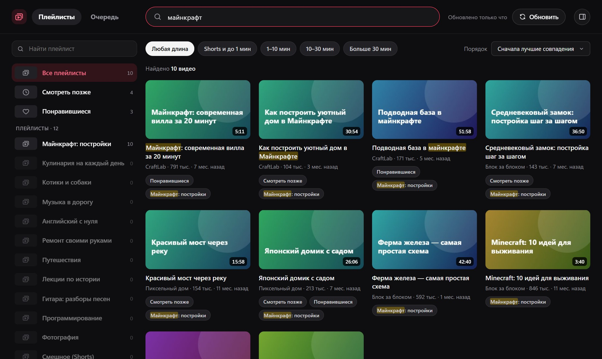

# Сводка комментариев YouTube

Расширение для Chrome: открываете видео — сбоку появляется панель с обзором обсуждения,
моментами по таймкодам, поиском и ИИ-сводкой комментариев. Плюс удобства для самого плеера:
клипы из видео, без автозапуска, без полосы прогресса, превью ролика.

**Бесплатно.** ИИ — бесплатный тариф Groq через свой сервер (ключ на сервере, в браузер
не попадает), всё остальное считается прямо в браузере.

Скриншоты сняты на клипе Rick Astley — Never Gonna Give You Up: 1000 настоящих
комментариев, сводка и ответ на вопрос — настоящие, от ИИ расширения.

## Установка (5 минут)

1. Скачайте или склонируйте репозиторий.
2. Откройте `chrome://extensions` и включите «Режим разработчика» (справа вверху).
3. «Загрузить распакованное расширение» → выберите папку репозитория.
4. Закрепите иконку расширения на панели Chrome (значок пазла → булавка).
5. Откройте панель (иконка или `Alt+Shift+Y`) → ⚙ Настройки → блок «Сервер с ИИ»:
   впишите секрет (`EXT_SECRET`), нажмите «Сохранить» и «Проверить связь».

Без секрета работает всё, кроме ИИ: обзор, моменты, фильтры, поиск по тексту, превью и
режимы плеера.

## Что умеет

### Панель (открывается на странице видео)

| Вкладка | Что там |
|---|---|
| **Сводка** | ИИ-сводка обсуждения: текст, настроение зрителей (клик по цветной полосе — примеры позитивных, нейтральных или негативных комментариев), главные темы, ключевые мнения, яркие комментарии. Ниже — **обзор без ИИ**: цифры, частые слова, популярные моменты (клик перематывает видео и открывает комментарии к моменту), самый залайканный комментарий и самая жаркая ветка. Сводку можно скопировать текстом, сохранить в `.md` или **картинкой** (PNG в буфер — вставить в Telegram через Ctrl+V). |
| **Моменты** | Места видео, на которые ссылаются зрители (таймкоды «1:23»): общий таймлайн с точками (крупнее — больше комментариев; колесо мыши приближает, приближенную полосу можно тянуть, двойной клик — всё видео; при наведении — сам комментарий; с клавиатуры — Tab на полосу и стрелки ← →) и у каждого момента своя полоса-таймлайн. Порядок — по ходу видео или самые обсуждаемые; моменты с одним комментарием спрятаны под кнопку. Клик по таймкоду или точке перематывает видео, клик по точке общего таймлайна ещё и прокручивает к комментариям момента. |
| **Темы** | На какие темы делится обсуждение (после ИИ-анализа), с примерами комментариев. |
| **Поиск** | Режимы «Текст» — мгновенно, «Смысл» (ИИ) и **вопрос к комментариям** (ИИ) — свой или готовый: «что понравилось?», «о чём спорят?». |
| **Все** | Все комментарии: фильтры «по лайкам», «обсуждаемые», «вопросы» (с «?» или явной просьбой — «подскажите», «где купить», а не восклицания вроде «Как же он хорош»), «с таймкодами», «новые с прошлой сводки», поиск по тексту и автору; **ответы в ветках** по кнопке «Ответы · N»; бейджи «автор» и сердечко от автора канала. |

Светлая тема, примеры комментариев по клику на полосу настроения и подсказка при наведении
на точку таймлайна:

Сводка картинкой — для Telegram и мессенджеров (кнопка «Картинка» копирует PNG в буфер):

Готовые сводки сохраняются (до 60 видео): при повторном открытии видео сводка показывается
сразу, без запросов к ИИ, а панель подсказывает, сколько новых комментариев появилось с тех
пор. Список — в настройках, «Недавние сводки».

### Клипы из видео

Выбираете отрезок — получаете файл, который можно сразу отправить друзьям (Telegram и любые
мессенджеры открывают его без YouTube):

- **Как открыть:** «Вырезать клип» в меню кнопки расширения в плеере, правым кликом на
  странице видео или по иконке расширения. Во вкладке «Моменты» боковой панели у каждого
  момента есть кнопка с ножницами — окно откроется сразу с отрезком вокруг него
  (5 с до таймкода и 20 с после), края можно подвинуть.
- **Выбор отрезка:** ручки на шкале (упираются друг в друга, а не толкают), время вручную
  («1:30», «1:02:03») или «Сейчас»; клавиши I и O (Ш и Щ) — начало и конец по кадру в
  предпросмотре, как в видеоредакторах; стрелки на ручке — ±1 с, с Shift — ±5 с.
- **Шкала:** на длинном видео сразу приближена к отрезку; колесо мыши — приблизить или
  отдалить, Shift+колесо — сдвинуть, двойной клик — всё видео; деления с подписями
  подстраиваются под масштаб, под курсором — точное время, мини-полоса ниже показывает,
  где вы во всём видео (рамку можно тянуть).
- **Предпросмотр:** кадр начала и конца прямо в окне, «Посмотреть отрезок» (или пробел)
  проигрывает выбранное. На больших мониторах окно крупнее.
- **Что сохранить:** MP4 720p или 1080p (H.264 + AAC — играет везде) либо только звук (M4A).
  До 3 минут. Выбор запоминается для следующих клипов.
- **Ссылка на момент:** кнопка «Ссылка» копирует ссылку на YouTube с начала клипа — для
  тех, кому удобнее открыть само видео.
- **Быстро:** клип не записывается в реальном времени — расширение берёт куски, которые
  плеер YouTube и так качает для показа, просит у него нужное качество и склеивает отрезок
  без перекодирования. 30 секунд в 1080p — несколько секунд, в каком бы качестве вы ни
  смотрели.
- **Точно по секундам:** клип начинается ровно с выбранного момента, хотя видео без
  перекодирования можно резать только по опорным кадрам: лишнее начало прячется списком
  правок MP4, его не видно ни в одном плеере.
- **Ограничения:** на время сбора видео в плеере перезагружается на секунду-другую и потом
  возвращается на место; в трансляциях клип не вырезается, а если перед видео реклама —
  окно дождётся её конца.

Только для личного использования: правила YouTube не разрешают распространять чужие ролики.

### Сохранение в плейлисты

Своё окно вместо стандартного «Сохранить»: сразу в несколько плейлистов, с поиском.

- **Как открыть:** «Сохранить в плейлисты» в меню кнопки расширения в плеере, `Alt+Shift+S`,
  кнопка «Сохранить» справа у Shorts или правый клик по странице. Правый клик по превью
  ролика в ленте сохраняет именно этот ролик — открывать видео не нужно.
- **Поиск:** печатайте название — список фильтруется, совпадения подсвечиваются. Если такого
  плейлиста нет, первой строкой будет «Создать «…»» — новый приватный плейлист сразу с видео.
- **Несколько сразу:** отмечайте галочками (пробел или клик), снимайте лишние — внизу видно,
  что изменится; «Сохранить» (Ctrl+Enter или Enter в пустом поиске) применяет всё разом.
  С клавиатуры: ↑/↓ — по списку, пробел или Enter — галочка, Esc — закрыть.
- **Удобно глазами:** обложки плейлистов, доступ (приватный, по ссылке, открытый) и когда
  обновлялся; наверху — плейлисты, куда вы сохраняли последними.
- Работает от вашего аккаунта теми же командами, что и сам сайт YouTube; ничего никуда больше
  не отправляется.

### Моя библиотека — поиск по всем плейлистам

Отдельная страница расширения: все видео из всех ваших плейлистов, включая «Смотреть позже» и
«Понравившиеся», и мгновенный поиск по ним.

- **Как открыть:** «Моя библиотека» в меню кнопки в плеере, правый клик на YouTube, кнопка в
  боковой панели или своя клавиша (`chrome://extensions/shortcuts`). Выделили текст на любой
  странице — правый клик → «Найти «…» в моих плейлистах».
- **Где открывать — выбираете вы:** во вкладке (всегда справа от текущей, уже открытая
  переезжает к вам) или прямо в боковой панели — кнопка справа в шапке библиотеки, выбор
  запоминается. В панели видео открывается в текущей вкладке.
- **Поиск понимает:** опечатки («майнкрафр»), окончания («котики» → «котик», «cooking» →
  «cook»), недописанные слова, запрос не в той раскладке («ghbdtn» → «привет»), исключения
  («музыка -remix»). Ищет по названию, каналу и названиям плейлистов, найденное подсвечено.
- **Плейлисты слева** — во время поиска у каждого видно, сколько в нём нашлось, а плейлисты с
  совпадениями поднимаются наверх. Фильтры по длине (Shorts, 1–10, 10–30, больше 30 минут) и
  порядок (по совпадению, как в плейлистах, по длине, по каналу).
- **Список хранится только в этом браузере.** Первый раз библиотека читает все плейлисты
  (100 плейлистов и ~20 тысяч видео — меньше минуты), потом обновляется сама, если ей больше
  12 часов, или по кнопке «Обновить». Нет открытой вкладки YouTube — библиотека на время откроет
  фоновую (раздел «Плейлисты», без звука) и закроет её.

### Очередь «посмотреть потом»

Вместо десятков вкладок «на потом» — один список и одна вкладка для просмотра.

- **«Собрать вкладки»** (в разделе «Очередь» библиотеки, правый клик на YouTube или своя
  клавиша): все вкладки с видео YouTube уходят в очередь вместе с местом, где вы остановились,
  и закрываются. Текущая и закреплённые остаются. Передумали — «Вернуть вкладки».
- **«Отложить в очередь»** в меню плеера или по правому клику: это видео — в очередь, вкладку
  закрыть. Правый клик по любой ссылке на видео — «Добавить в очередь».
- **Смотреть — в одной вкладке.** Клик по видео в очереди открывает его с того места, где вы
  остановились. Над рекомендациями YouTube — панель очереди: «Назад / Досмотрел / Дальше» и
  ближайшие видео. Клавиши: `]` — дальше, `[` — назад, `Shift+]` — досмотрел (убрать и дальше).
- **Досмотрели — видео уходит из очереди** (с кнопкой «Вернуть»), а поверх плеера — подборка
  «Что посмотреть дальше»: 2, 4 или 6 видео по порядку, вперемешку, сначала короткие, начатые
  или похожие (тот же канал или похожие названия). Можно включить, чтобы следующее запускалось
  само.
- **«Средний клик — в очередь»** (по желанию): средний клик или Ctrl+клик по видео на YouTube
  кладёт его в очередь вместо новой вкладки — с подсказкой «Открыть сейчас» и «Отменить».
- В очереди — поиск, сортировка, «Наверх», «Убрать», сколько видео и часов осталось смотреть;
  начатые видео — крупно сверху, в полосе «Продолжить смотреть». На странице видео YouTube
  очередь справа — галереей: следующее крупно, остальные плиткой.

### Смотреть прямо в библиотеке

Клик по видео в библиотеке или очереди открывает его тут же, во встроенном плеере YouTube —
он заметно легче полной страницы сайта: большой плеер, «Досмотрел» и «Дальше», справа —
галерея «Дальше в очереди» (или следующие результаты поиска). Место просмотра запоминается,
в конце видео — та же подборка. Клавиши: `Esc` — к списку, `]` / `[` — дальше и назад,
`Shift+]` — досмотрел. Видео, которые автор запретил встраивать, открываются кнопкой
«На YouTube». Выключить — «Смотреть прямо здесь» в настройках очереди.

### Плеер YouTube

- **Не запускать видео автоматически** — видео ждёт, пока вы сами нажмёте play (клик по
  плееру, K, пробел, Enter по кнопке play, медиаклавиша на клавиатуре/наушниках или клик по
  таймкоду в описании и комментариях). Не проигрывается ни доли секунды. Shorts листаются
  как обычно, мини-плеер разворачивается без паузы, а включённый посреди видео автостоп
  уже играющее видео не останавливает.
- **Скрыть полосу прогресса и длительность** — не видно, сколько осталось до конца; текущее
  время и перемотка стрелками остаются.
- **Превью видео** — прямо поверх страницы YouTube: выбор качества (← →), скачивание с именем
  по шаблону (D), копирование в буфер (C), закрытие — Esc или клик мимо.

Включаются там, где удобно:

- **кнопка в плеере** рядом с шестерёнкой настроек — своё меню в стиле YouTube;
- **правый клик** на странице YouTube или по иконке расширения (по превью в ленте — для
  того видео, по которому щёлкнули);
- **горячие клавиши**: `Alt+Shift+K` — автозапуск, `Alt+Shift+H` — полоса прогресса,
  `Alt+Shift+Y` — открыть панель, `Alt+Shift+S` — сохранить в плейлисты; без клавиши по
  умолчанию, но можно назначить: «Моя библиотека», «Собрать вкладки в очередь», «Отложить
  видео» (всё — на `chrome://extensions/shortcuts`);
- **настройки** панели, блок «Плеер YouTube».

Внутри панели: `1`–`5` — вкладки, `/` — поиск, `Esc` — выйти из поля.

## Настройки

- **Плеер YouTube** — два переключателя выше, применяются сразу.
- **Сбор и анализ** — лимит комментариев (10–2000, по умолчанию 120), какие собирать
  (сначала популярные или сначала новые), язык сводки, тема (как в системе / тёмная /
  светлая), режим сбора, шаблон имени файла превью (`{title}`, `{channel}`, `{videoid}`).
- **Недавние сводки** — список проанализированных видео, очистка истории.
- **Сервер с ИИ** — адрес сервера (по умолчанию бот на Render), секрет, модель.

## Бесплатный лимит Groq

Ключ Groq общий с ботом, а бесплатный тариф пропускает примерно 7 тыс. входных и 1 тыс.
выходных токенов в минуту. Расширение держит темп само: режет комментарии на части, ждёт окно
лимита (в панели виден обратный отсчёт) и дробит запрос при превышении. В ИИ-сводку идут
максимум 200 самых залайканных комментариев — это примерно полторы минуты. Поиск по смыслу и
вопросы отправляют в ИИ только подходящие под бюджет комментарии.

Бесплатный Render засыпает после ~15 минут простоя: панель будит сервер заранее, пока вы
смотрите обзор, и пишет «Сервер просыпается…», если это заметно. Free-тариф ограничен
750 ч/мес — если лимит кончится, переключитесь на локальный бэкенд (`http://localhost:8080`).

## Если что-то не работает

- **Сначала — «Проверить, всё ли работает»** (настройки → блок «Проверка»). За 10–20 секунд
  расширение прогоняет основные запросы — только чтение, в аккаунте ничего не меняется — и
  по каждому пункту пишет «работает» или что сломалось и что делать: сервер сводок (ИИ),
  сбор комментариев, плейлисты и «Смотреть позже» / «Понравившиеся» (с переходом на
  следующую страницу), обложки, встроенный плеер «Моей библиотеки» (пропавшее правило
  восстанавливается само). Дата и итог последней проверки сохраняются. Раз в сутки
  проверка идёт сама, тихо, если открыт YouTube (выключается там же); нашлась поломка —
  на значке расширения «!», а сверху панели — плашка «Сломалось: …».
- **Панель пишет «Обновите страницу видео»** — расширение обновили после открытия вкладки:
  нажмите F5 на странице видео.
- **«Собрано 1500 из 2000 · сбор прервался»** — YouTube оборвал выдачу или сбор остановили;
  собранное сохранено и уже работает, «собрать заново» — попробовать снова.
- **«Сервер не отвечает»** — проверьте адрес и секрет в настройках («Проверить связь»).
- **Не срабатывают горячие клавиши** — сочетание занято другим расширением: назначьте своё на
  `chrome://extensions/shortcuts`.
- **Подробности для разработчика** — в настройках внизу, «диагностика».

## Чтобы Chrome не отключал расширение

- Распакованное расширение работает, пока включён «Режим разработчика» и папка лежит на
  месте. Если Chrome при запуске предлагает отключить расширения разработчика — не соглашайтесь.
- Расширение на Manifest V3 — из-за прекращения поддержки MV2 (как у старых AutoplayStopper
  и ToggleVideoProgressBars) Chrome его не отключит.
- `.crx`, установленный не из магазина, Chrome на Windows отключает сам — рассылать его
  бесполезно. Надёжно раздать друзьям — Chrome Web Store «по ссылке» (разовый взнос $5) или
  бесплатный Microsoft Edge Add-ons.

## Для разработчика

- `manifest.json` — MV3: storage, sidePanel, downloads, tabs, contextMenus, scripting (библиотека клипов по требованию), alarms (самопроверка раз в сутки); горячие клавиши.
- `background.js` — service worker (модуль): панель, контекстное меню, клавиши, действия
  кнопки плеера.
- `selfcheck.js` — самопроверка («Проверить, всё ли работает»): запускает фон по кнопке и
  раз в сутки (`chrome.alarms`); комментарии проверяет командой `yt:selfcheck` в `content.js`
  (тем же кодом разбора), плейлисты — через `playlists-main.js`, итог — в `storage.local`
  (`selfcheck`), значок «!» — `chrome.action.setBadgeText`. Блок в настройках —
  `sidepanel/selfcheck-ui.js`.
- `early.js` — на youtube.com с самого начала загрузки (`document_start`): настройки плеера,
  скрытие полосы прогресса и запасная пауза при автозапуске.
- `early-main.js` — в мире самой страницы (`world: "MAIN"`): отклоняет `play()` плеера без
  вашего действия, так что видео не проигрывает ни доли секунды.
- `clip-main.js` — в мире страницы: захват кусков видео, которые плеер передаёт в
  `SourceBuffer`, разбор фрагментов MP4, на время клипа — H.264 вместо AV1/VP9, возврат плеера.
- `clip.js` — окно «Вырезать клип», склейка без перекодирования библиотекой
  [Mediabunny](https://github.com/Vanilagy/mediabunny) (`vendor/mediabunny.js` — собрана из npm-пакета скриптом `vendor/build-mediabunny.mjs`, лицензия MPL-2.0; вставляется во вкладку по первому клипу) и сохранение.
- `playlists-main.js` — в мире страницы: запросы к YouTube для плейлистов (список с отметками,
  добавить/убрать, создать, обложки библиотеки) с настройками самого сайта.
- `playlists.js` — окно «Сохранить в плейлисты», кнопка на Shorts, недавние и обложки в
  `chrome.storage.local`.
- `library/` — страница «Моя библиотека»: `library.js` (каталог плейлистов в IndexedDB — запросы
  идут через вкладку YouTube и `playlists-main.js`; раздел «Очередь»; режим боковой панели
  `?panel=1`), `search.js` (поиск без сети: опечатки, основы слов, раскладка, подсветка).
- Встроенный плеер на странице расширения: правило `declarativeNetRequest` (без лишних
  разрешений — `WithHostAccess`) ставит заголовок `Referer` только запросам к `youtube.com/embed`
  с наших страниц — иначе YouTube отвечает «Ошибка 153».
- `queue.js` — на youtube.com: панель очереди над рекомендациями, место просмотра, подборка в
  конце видео, клавиши `[` `]`, «средний клик — в очередь», «Отложить». Пишет очередь только
  `background.js` (по сообщениям, по одному изменению за раз).
- `content.js` — на youtube.com: метаданные, сбор комментариев через InnerTube
  (`youtubei/v1/next`) с fallback на DOM, ответы в ветках, перемотка, кнопка и меню в плеере,
  превью поверх страницы.
- `groq.js` — клиент прокси `POST /api/chat` (обычный и SSE-стриминг, таймауты, повторы,
  `SerialQueue`); `prompts.js` — промпты; `config.js` — публичные значения по умолчанию.
- `sidepanel/` — панель (`sidepanel.html/css/js`), локальная аналитика (`insights.js`),
  иконки (`icons.js`), сводка картинкой (`card.js`), страница превью (`preview.*`).
- Бэкенд — репозиторий `ShurikPozd/tg-saver-bot-cloud`, эндпоинт `POST /api/chat` с
  заголовком `X-Sec-Token`. Если сервер не на `localhost:8080` и не на `*.onrender.com`,
  добавьте его в `host_permissions`.
- Секреты не хранятся в коде: `EXT_SECRET` — в настройках или в gitignored `local-config.js`
  (см. `local-config.example.js`).
- Перед коммитом: `bash check-syntax.sh` (разбор модулей как ESM, проверка экспортов и
  констант).
