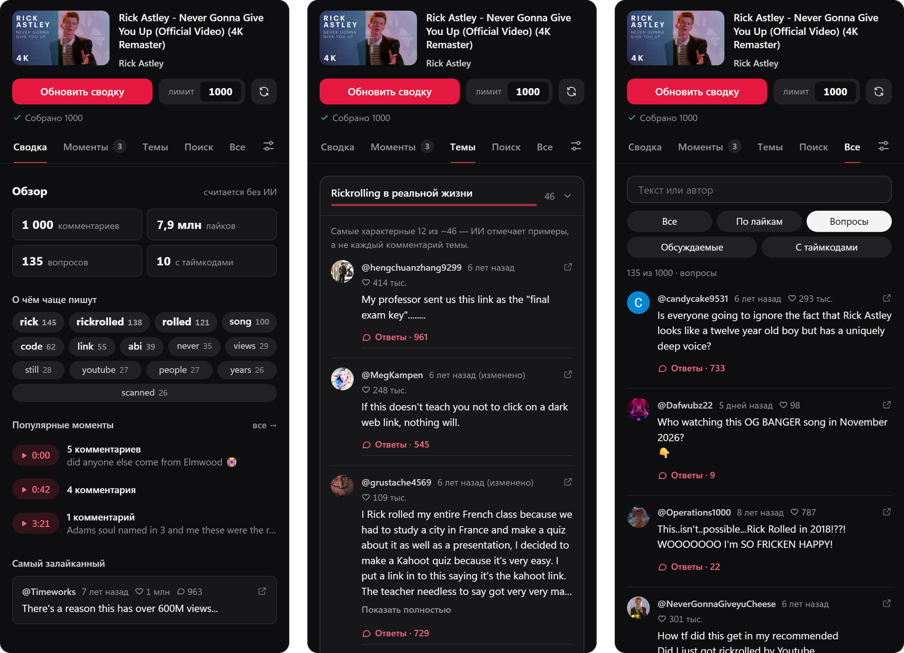
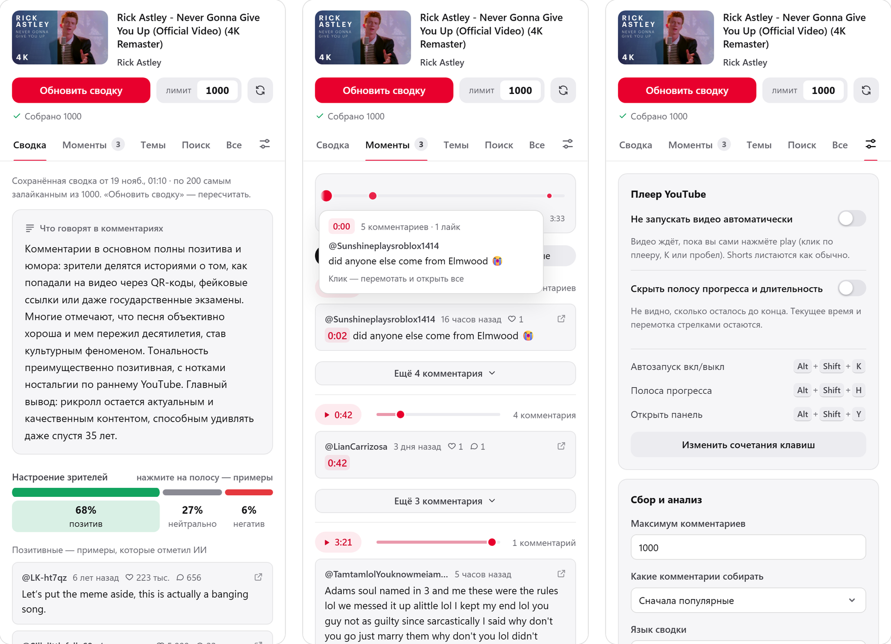
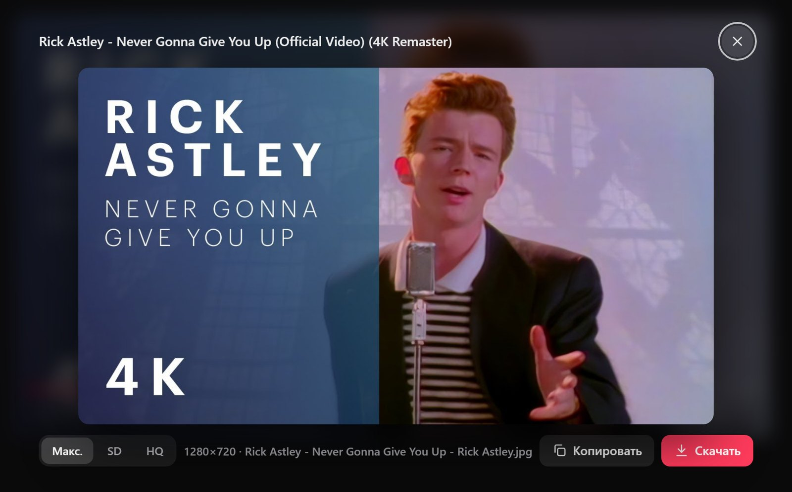

# Сводка комментариев YouTube

Расширение для Chrome: открываете видео — сбоку появляется панель с обзором обсуждения,
моментами по таймкодам, поиском и ИИ-сводкой комментариев. Плюс удобства для самого плеера:
без автозапуска, без полосы прогресса, превью ролика.

**Бесплатно.** ИИ — бесплатный тариф Groq через свой сервер (ключ на сервере, в браузер
не попадает), всё остальное считается прямо в браузере.

Скриншоты сняты на клипе Rick Astley — Never Gonna Give You Up: 1000 настоящих
комментариев, сводка и ответ на вопрос — настоящие, от ИИ расширения.

## Установка (5 минут)

1. Скачайте или склонируйте репозиторий.
2. Откройте `chrome://extensions` и включите «Режим разработчика» (справа вверху).
3. «Загрузить распакованное расширение» → выберите папку репозитория.
4. Закрепите иконку расширения на панели Chrome (значок пазла → булавка).
5. Откройте панель (иконка или `Alt+Shift+Y`) → ⚙ Настройки → блок «Сервер с ИИ»:
   впишите секрет (`EXT_SECRET`), нажмите «Сохранить» и «Проверить связь».

Без секрета работает всё, кроме ИИ: обзор, моменты, фильтры, поиск по тексту, превью и
режимы плеера.

## Что умеет

### Панель (открывается на странице видео)

| Вкладка | Что там |
|---|---|
| **Сводка** | ИИ-сводка обсуждения: текст, настроение зрителей (клик по цветной полосе — примеры позитивных, нейтральных или негативных комментариев), главные темы, ключевые мнения, яркие комментарии. Ниже — **обзор без ИИ**: цифры, частые слова, популярные моменты (клик перематывает видео и открывает комментарии к моменту), самый залайканный комментарий и самая жаркая ветка. Сводку можно скопировать текстом, сохранить в `.md` или **картинкой** (PNG в буфер — вставить в Telegram через Ctrl+V). |
| **Моменты** | Места видео, на которые ссылаются зрители (таймкоды «1:23»): общий таймлайн с точками (крупнее — больше комментариев; колесо мыши приближает, приближенную полосу можно тянуть, двойной клик — всё видео; при наведении — сам комментарий; с клавиатуры — Tab на полосу и стрелки ← →) и у каждого момента своя полоса-таймлайн. Порядок — по ходу видео или самые обсуждаемые; моменты с одним комментарием спрятаны под кнопку. Клик по таймкоду или точке перематывает видео, клик по точке общего таймлайна ещё и прокручивает к комментариям момента. |
| **Темы** | На какие темы делится обсуждение (после ИИ-анализа), с примерами комментариев. |
| **Поиск** | Режимы «Текст» — мгновенно, «Смысл» (ИИ) и **вопрос к комментариям** (ИИ) — свой или готовый: «что понравилось?», «о чём спорят?». |
| **Все** | Все комментарии: фильтры «по лайкам», «обсуждаемые», «вопросы» (с «?» или явной просьбой — «подскажите», «где купить», а не восклицания вроде «Как же он хорош»), «с таймкодами», «новые с прошлой сводки», поиск по тексту и автору; **ответы в ветках** по кнопке «Ответы · N»; бейджи «автор» и сердечко от автора канала. |

Светлая тема, примеры комментариев по клику на полосу настроения и подсказка при наведении
на точку таймлайна:

Сводка картинкой — для Telegram и мессенджеров (кнопка «Картинка» копирует PNG в буфер):

Готовые сводки сохраняются (до 60 видео): при повторном открытии видео сводка показывается
сразу, без запросов к ИИ, а панель подсказывает, сколько новых комментариев появилось с тех
пор. Список — в настройках, «Недавние сводки».

### Плеер YouTube

- **Не запускать видео автоматически** — видео ждёт, пока вы сами нажмёте play (клик по
  плееру, K, пробел, Enter по кнопке play, медиаклавиша на клавиатуре/наушниках или клик по
  таймкоду в описании и комментариях). Не проигрывается ни доли секунды. Shorts листаются
  как обычно, мини-плеер разворачивается без паузы, а включённый посреди видео автостоп
  уже играющее видео не останавливает.
- **Скрыть полосу прогресса и длительность** — не видно, сколько осталось до конца; текущее
  время и перемотка стрелками остаются.
- **Превью видео** — прямо поверх страницы YouTube: выбор качества (← →), скачивание с именем
  по шаблону (D), копирование в буфер (C), закрытие — Esc или клик мимо.

Включаются там, где удобно:

- **кнопка в плеере** рядом с шестерёнкой настроек — своё меню в стиле YouTube;
- **правый клик** на странице YouTube или по иконке расширения (по превью в ленте — для
  того видео, по которому щёлкнули);
- **горячие клавиши**: `Alt+Shift+K` — автозапуск, `Alt+Shift+H` — полоса прогресса,
  `Alt+Shift+Y` — открыть панель (меняются на `chrome://extensions/shortcuts`);
- **настройки** панели, блок «Плеер YouTube».

Внутри панели: `1`–`5` — вкладки, `/` — поиск, `Esc` — выйти из поля.

## Настройки

- **Плеер YouTube** — два переключателя выше, применяются сразу.
- **Сбор и анализ** — лимит комментариев (10–2000, по умолчанию 120), какие собирать
  (сначала популярные или сначала новые), язык сводки, тема (как в системе / тёмная /
  светлая), режим сбора, шаблон имени файла превью (`{title}`, `{channel}`, `{videoid}`).
- **Недавние сводки** — список проанализированных видео, очистка истории.
- **Сервер с ИИ** — адрес сервера (по умолчанию бот на Render), секрет, модель.

## Бесплатный лимит Groq

Ключ Groq общий с ботом, а бесплатный тариф пропускает примерно 7 тыс. входных и 1 тыс.
выходных токенов в минуту. Расширение держит темп само: режет комментарии на части, ждёт окно
лимита (в панели виден обратный отсчёт) и дробит запрос при превышении. В ИИ-сводку идут
максимум 200 самых залайканных комментариев — это примерно полторы минуты. Поиск по смыслу и
вопросы отправляют в ИИ только подходящие под бюджет комментарии.

Бесплатный Render засыпает после ~15 минут простоя: панель будит сервер заранее, пока вы
смотрите обзор, и пишет «Сервер просыпается…», если это заметно. Free-тариф ограничен
750 ч/мес — если лимит кончится, переключитесь на локальный бэкенд (`http://localhost:8080`).

## Если что-то не работает

- **Панель пишет «Обновите страницу видео»** — расширение обновили после открытия вкладки:
  нажмите F5 на странице видео.
- **«Собрано 1500 из 2000 · сбор прервался»** — YouTube оборвал выдачу или сбор остановили;
  собранное сохранено и уже работает, «собрать заново» — попробовать снова.
- **«Сервер не отвечает»** — проверьте адрес и секрет в настройках («Проверить связь»).
- **Не срабатывают горячие клавиши** — сочетание занято другим расширением: назначьте своё на
  `chrome://extensions/shortcuts`.
- **Подробности для разработчика** — в настройках внизу, «диагностика».

## Чтобы Chrome не отключал расширение

- Распакованное расширение работает, пока включён «Режим разработчика» и папка лежит на
  месте. Если Chrome при запуске предлагает отключить расширения разработчика — не соглашайтесь.
- Расширение на Manifest V3 — из-за прекращения поддержки MV2 (как у старых AutoplayStopper
  и ToggleVideoProgressBars) Chrome его не отключит.
- `.crx`, установленный не из магазина, Chrome на Windows отключает сам — рассылать его
  бесполезно. Надёжно раздать друзьям — Chrome Web Store «по ссылке» (разовый взнос $5) или
  бесплатный Microsoft Edge Add-ons.

## Для разработчика

- `manifest.json` — MV3: storage, sidePanel, downloads, tabs, contextMenus; горячие клавиши.
- `background.js` — service worker (модуль): панель, контекстное меню, клавиши, действия
  кнопки плеера.
- `early.js` — на youtube.com с самого начала загрузки (`document_start`): настройки плеера,
  скрытие полосы прогресса и запасная пауза при автозапуске.
- `early-main.js` — в мире самой страницы (`world: "MAIN"`): отклоняет `play()` плеера без
  вашего действия, так что видео не проигрывает ни доли секунды.
- `content.js` — на youtube.com: метаданные, сбор комментариев через InnerTube
  (`youtubei/v1/next`) с fallback на DOM, ответы в ветках, перемотка, кнопка и меню в плеере,
  превью поверх страницы.
- `groq.js` — клиент прокси `POST /api/chat` (обычный и SSE-стриминг, таймауты, повторы,
  `SerialQueue`); `prompts.js` — промпты; `config.js` — публичные значения по умолчанию.
- `sidepanel/` — панель (`sidepanel.html/css/js`), локальная аналитика (`insights.js`),
  иконки (`icons.js`), сводка картинкой (`card.js`), страница превью (`preview.*`).
- Бэкенд — репозиторий `ShurikPozd/tg-saver-bot-cloud`, эндпоинт `POST /api/chat` с
  заголовком `X-Sec-Token`. Если сервер не на `localhost:8080` и не на `*.onrender.com`,
  добавьте его в `host_permissions`.
- Секреты не хранятся в коде: `EXT_SECRET` — в настройках или в gitignored `local-config.js`
  (см. `local-config.example.js`).
- Перед коммитом: `bash check-syntax.sh` (разбор модулей как ESM, проверка экспортов и
  констант).
