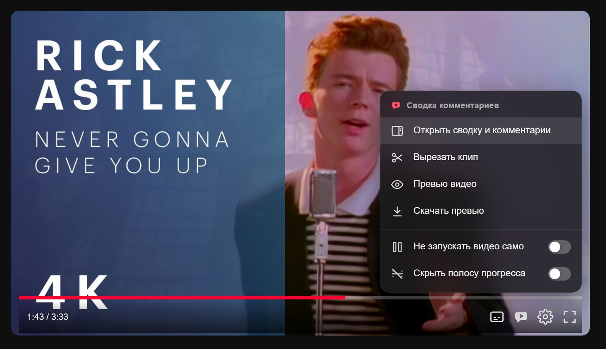
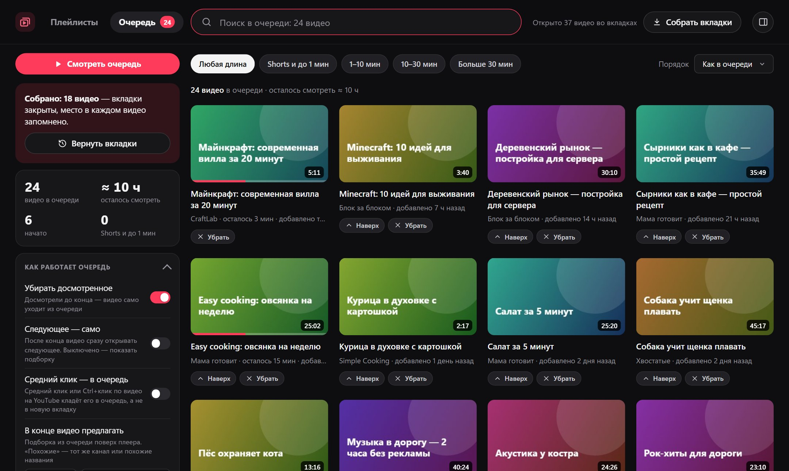

# Сводка комментариев YouTube

Расширение для Chrome, которое делает YouTube удобнее. Начиналось как ИИ-сводка
комментариев в боковой панели, а теперь это набор для всего YouTube:

- **«Моя библиотека»** — все видео из всех ваших плейлистов и мгновенный поиск по ним: с
  опечатками, по смыслу и по словам в субтитрах; **очередь** вместо сотен вкладок;
  **«Подписки»** — дайджест новых видео; **«Статистика»** — сколько смотрите и сколько
  сэкономили.
- **Плеер** — без автозапуска, скорость и громкость по каналам (до 4× и до 300 %), пропуск
  рекламных вставок и тишины, таймер сна, режим «Без отвлечений», клипы из видео, заметки с
  таймкодами.
- **ИИ** — сводка комментариев, пересказ видео по субтитрам (в панели и прямо на обложках),
  архив видео в своём Telegram-боте.

**Бесплатно.** ИИ — бесплатный тариф Groq через свой сервер (ключ на сервере, в браузер
не попадает), всё остальное считается прямо в браузере.

Скриншоты панели сняты на клипе Rick Astley — Never Gonna Give You Up: 1000 настоящих
комментариев, сводка и ответ на вопрос — настоящие, от ИИ расширения.

## Оглавление

- [Установка](#установка-5-минут)
- [Панель на странице видео](#панель-на-странице-видео) — сводка комментариев, «О видео»,
  моменты, поиск
- [Плеер YouTube](#плеер-youtube) — автозапуск, скорость, громкость, реклама, тишина, таймер сна,
  [«Без отвлечений»](#без-отвлечений), [заметки с таймкодами](#заметки-с-таймкодами)
- [На обложках](#на-обложках-о-чём-видео-превью-в-архив-telegram) — «О чём видео», «Превью»,
  «В архив Telegram»
- [Клипы из видео](#клипы-из-видео) · [Сохранение в плейлисты](#сохранение-в-плейлисты)
- [Моя библиотека](#моя-библиотека) — поиск, [по субтитрам](#поиск-по-субтитрам),
  [просмотр прямо в библиотеке](#смотреть-прямо-в-библиотеке)
- [Очередь](#очередь-посмотреть-потом) · [Подписки](#подписки--дайджест-новых-видео) ·
  [Статистика](#статистика-просмотра) и [мягкий лимит](#мягкий-лимит-времени) · [Поиск из адресной строки](#поиск-из-адресной-строки)
- [Клавиши](#клавиши) · [Где что включается](#где-что-включается) · [Настройки](#настройки)
- [Бесплатный лимит Groq](#бесплатный-лимит-groq) ·
  [Если что-то не работает](#если-что-то-не-работает) ·
  [Чтобы Chrome не отключал расширение](#чтобы-chrome-не-отключал-расширение) ·
  [В Яндекс Браузере](#в-яндекс-браузере)
- [Для разработчика](#для-разработчика)

## Установка (5 минут)

1. Скачайте или склонируйте репозиторий.
2. Откройте `chrome://extensions` и включите «Режим разработчика» (справа вверху).
3. «Загрузить распакованное расширение» → выберите папку репозитория.
4. Закрепите иконку расширения на панели Chrome (значок пазла → булавка).
5. Откройте панель (иконка или `Alt+Shift+Y`) → ⚙ Настройки → блок «Сервер с ИИ»:
   впишите секрет (`EXT_SECRET`) — он сохранится сам — и нажмите «Проверить связь».

Без секрета работает всё, кроме ИИ (сводка, пересказ, вопросы к комментариям, архив
Telegram): обзор, моменты, фильтры, библиотека, очередь, плеер и превью.

**«Что умеет расширение»** — короткая страница со всеми возможностями, клавишами и списком
«Что нового». Открывается сама после установки, потом — строкой вверху настроек панели и
кнопкой «?» в шапке «Моей библиотеки». После крупного обновления (0.26 → 0.27) новая вкладка
не открывается: на значке расширения появляется «NEW», в панели — плашка «Новая версия ·
Что нового», а на странице новое отмечено. Мелкие обновления ничего не показывают.

## Панель на странице видео

Открывается иконкой расширения или `Alt+Shift+Y`. Комментарии собираются сами.

| Вкладка | Что там |
|---|---|
| **Сводка** | ИИ-сводка обсуждения: текст, настроение зрителей (клик по цветной полосе — примеры позитивных, нейтральных или негативных комментариев), главные темы, ключевые мнения, яркие комментарии. Ниже — **обзор без ИИ**: цифры, частые слова, популярные моменты, самый залайканный комментарий и самая жаркая ветка. Сводку можно скопировать текстом, сохранить в `.md` или **картинкой** (PNG в буфер — вставить в Telegram через Ctrl+V). |
| **О видео** | Пересказ **самого видео** по субтитрам: 3–5 предложений «о чём видео» и 5–8 главных пунктов с таймкодами — клик перематывает видео. Подробнее — ниже. |
| **Моменты** | Места видео, на которые ссылаются зрители (таймкоды «1:23»): общий таймлайн с точками (крупнее — больше комментариев; колесо мыши приближает, приближенную полосу можно тянуть, двойной клик — всё видео; с клавиатуры — Tab на полосу и стрелки ← →) и у каждого момента своя полоса. Порядок — по ходу видео или самые обсуждаемые. Клик по таймкоду или точке перематывает видео; ножницы у момента — [клип](#клипы-из-видео) вокруг него. |
| **Темы** | На какие темы делится обсуждение (после ИИ-анализа), с примерами комментариев. |
| **Поиск** | «Текст» — мгновенно, «Смысл» (ИИ) и **вопрос к комментариям** (ИИ) — свой или готовый: «что понравилось?», «о чём спорят?». |
| **Все** | Все комментарии: фильтры «по лайкам», «обсуждаемые», «вопросы» (с «?» или явной просьбой — «подскажите», «где купить»), «с таймкодами», «новые с прошлой сводки», поиск по тексту и автору; **ответы в ветках** по кнопке «Ответы · N»; бейджи «автор» и сердечко от автора канала. |

Светлая тема, примеры комментариев по клику на полосу настроения и подсказка при наведении
на точку таймлайна:

Сводка картинкой — для Telegram и мессенджеров (кнопка «Картинка» копирует PNG в буфер):

Готовые сводки сохраняются (до 60 видео): при повторном открытии видео сводка показывается
сразу, без запросов к ИИ, а панель подсказывает, сколько новых комментариев появилось с тех
пор. Список — в настройках, «Недавние сводки». Кнопка «Библиотека» над вкладками открывает
«Мою библиотеку».

### «О видео» — пересказ по субтитрам

Вкладка **«О видео»** → «Пересказать видео»: ИИ читает субтитры ролика и пишет, о чём он, —
коротко и только по фактам, а ниже 5–8 главных пунктов по ходу видео с таймкодами. Текст
появляется по мере ответа модели и сохраняется на этом компьютере (до 60 видео): повторно —
сразу, без запросов к ИИ. Кеш общий с кнопкой «О чём видео» на обложках.

- Берутся субтитры на языке видео: авторские, а если их нет — автоматические YouTube.
  Главы автора тоже подсказывают структуру. У видео без субтитров (музыка без слов) панель
  так и скажет: пересказывать не из чего.
- Короткое видео — один запрос, обычно 10–30 секунд. Длинное идёт частями: конспект каждой
  части, потом итог (видео на 35 минут — около двух минут). Совсем длинные (1,5 ч+)
  пересказываются по равномерно сокращённой расшифровке — панель это помечает.
- Работает и на странице видео, и во встроенном плеере «Моей библиотеки».

## Плеер YouTube

- **Не запускать видео автоматически** — видео ждёт, пока вы сами нажмёте play (клик по
  плееру, K, пробел, медиаклавиша или клик по таймкоду). Не проигрывается ни доли секунды.
  Shorts листаются как обычно, мини-плеер разворачивается без паузы, а включённый посреди
  видео автостоп уже играющее видео не останавливает.
- **Скрыть полосу прогресса и длительность** — не видно, сколько осталось до конца; текущее
  время и перемотка стрелками остаются.
- **Пропускать рекламные вставки** (включено сразу) — реклама спонсора, самореклама и
  просьбы подписаться перескакиваются сами; поверх плеера на несколько секунд —
  «Пропущено: реклама спонсора · Вернуть» («Вернуть» — к началу вставки, и до конца этого
  видео она больше не пропускается). Вставки отмечены цветными отрезками на полосе
  прогресса. Для каждого вида — «Пропуск», «Отметка» (отрезок на полосе и кнопка
  «Пропустить») или «Нет»: реклама спонсора, самореклама, просьба подписаться, заставка,
  титры, повтор, не по теме, заполнитель. По умолчанию первые три пропускаются, остальные
  только отмечаются.

  Разметку вставок делают зрители — открытая база сообщества
  [SponsorBlock](https://sponsor.ajay.app/) (автор — Ajay Ramachandran и участники), лицензия
  данных [CC BY-NC-SA 4.0](https://creativecommons.org/licenses/by-nc-sa/4.0/deed.ru).
  Бесплатно и без ключей. Запрос приватный: на сервер уходят только первые 4 символа хеша
  SHA-256 от id видео — сервер не знает, какое видео вы смотрите. Ответ хранится до закрытия
  браузера (не дольше 2 часов).
- **Скорость по каналам** (включено сразу) — поменяйте скорость в видео (меню YouTube или
  `Shift+>` / `Shift+<`), и она запомнится для этого канала: в его следующих видео включится
  сама, поверх плеера — «Скорость 1,5× для канала «…» · Сбросить». У канала без запомненной
  скорости видео идёт с обычной 1× — скорость прошлого ролика не «переезжает». Прямые эфиры,
  реклама и Shorts не трогаются; «удерживайте для 2×» не запоминается. Список каналов со
  скоростью и кнопкой «убрать» — в настройках панели.
- **Быстрее 2×** — YouTube сам не ускоряет больше 2×, расширение — до 4×: `Shift+>` после 2×
  идёт дальше шагом 0,25, `Shift+<` — обратно; на первом экране меню кнопки расширения в
  плеере — строка «Скорость − 1× +» (от 0,25× до 4×, меню не закрывается). Такая скорость тоже
  запоминается для канала. Переключатель «Скорость по каналам» и «Сбросить скорость канала» —
  в разделе меню «Плеер ›».
- **Громкость по каналам** (включено сразу) — поменяйте громкость в видео (ползунок YouTube,
  `↑` / `↓`, колесо над громкостью плеера или строка «Громкость − 100 % +» на первом экране меню
  кнопки расширения в плеере), и она запомнится для этого канала: в его следующих видео
  включится сама, поверх плеера — «Громкость 150 % для канала «…» · Сбросить». У канала без
  запомненной громкости — ваша обычная громкость, громкость прошлого ролика не «переезжает».
  Можно **громче 100 %** — до 300 % (колесом или кнопкой +): ползунок YouTube стоит на 100 %,
  остальное — усиление звука. Не нужно запоминать — «Отменить» на плашке «Запомнено: …»: громкость
  останется только для этого видео. Реклама, прямые эфиры и Shorts не трогаются.
  Переключатели «Громкость по каналам», «Выравнивать громкость» и «Сбросить громкость канала» —
  в разделе меню «Плеер ›»; список каналов с громкостью и кнопкой «убрать» — в настройках панели.
- **Пропускать вступления по каналам** (включено сразу) — в видео канала дойдите до конца
  заставки и нажмите `Shift+I` (или «Вступление до сюда» в разделе меню «Плеер ›»): в его
  следующих видео вступление пропустится само, поверх плеера — «Вступление пропущено · Вернуть»
  («Вернуть» — к началу, и в этом видео больше не пропускается). Вступление — от 3 секунд до
  5 минут. Отмечать не обязательно: если в первые ~60 с вы сами перемотали вперёд на одно и то
  же место (±5 с) в двух видео канала, плашка спросит «Пропускать вступление канала — до 0:41?
  · Пропускать · Не надо» («Не надо» — больше не спросит про этот канал). Реклама, прямые эфиры
  и Shorts не трогаются; не пропускается и ролик, открытый ссылкой с меткой времени (`&t=`),
  ролик, которому «С того же места» возвращает место, и ролик, который YouTube сам начал не с
  начала. Переключатель и «Сбросить вступление канала» — в разделе меню «Плеер ›».
- **Выравнивать громкость** (выключено сразу) — тихие места громче, громкие тише: не нужно то
  прибавлять, то убавлять звук в подкастах и фильмах. Рекламу не трогает.
- **Пропускать тишину** (выключено сразу) — паузы между фразами в лекциях и подкастах
  проходят в 2,5 раза быстрее (не выше 4×), а речь — с вашей скоростью: минус 10–20 % времени
  без ускорения голоса. Паузы короче четверти секунды не трогаются, порог тишины
  подстраивается под каждый ролик. Реклама, эфиры, музыка и Shorts не трогаются. Переключатель —
  в разделе меню «Плеер ›», под ним — «Сэкономлено сегодня: 3 мин».
- **Таймер сна** — на первом экране меню кнопки расширения в плеере: 15 / 30 / 45 / 60 / 90 мин,
  «В конце видео» или «Выключить»; в правом клике — «Таймер сна ›» (15, 30, 60 мин, в конце
  видео, выключить). Время идёт по часам и только пока видео играет, таймер переживает переход к
  следующему видео. За 20 с до конца звук плавно затихает (плашка «Видео остановится через
  20 с · Ещё 15 мин»), затем пауза, выход из полноэкранного режима и прежняя громкость.
  «В конце видео» — пауза за долю секунды до конца, так что ни YouTube, ни очередь не включат
  следующее. Пока таймер идёт, в меню видно «осталось 23 мин», а на кнопке расширения в
  плеере — красная точка.
- **С того же места** — нажали F5 (или «Назад», или браузер восстановил вкладки) — видео
  продолжается с той же секунды, а не на ~20 с раньше, как ставит сам YouTube по своей
  истории просмотра. Закрыли вкладку или браузер и открыли ролик снова (место хранится до двух
  месяцев, последние 400 роликов): если YouTube сам поставил его чуть раньше — расширение тихо
  догонит, а если начал с нуля — сверху плеера плашка «Вы остановились на 12:34 · Продолжить».
  Реклама перед роликом не мешает; первые полминуты, титры в конце и ссылки с меткой времени
  (`&t=`) не трогаются; перемотали сами, пока ролик грузился, — расширение не вмешивается.
- **Двойные субтитры** (выключено сразу) — в иностранном видео под строкой оригинала идёт
  перевод (по умолчанию на русский) — одной плашкой над полосой прогресса, перевод — розовым и
  чуть мельче. Перевод — автоперевод самого YouTube: без ИИ, лимитов и ключей. Есть ручные
  русские субтитры — берутся они. Строки идут по времени при любой скорости и перемотке, плашка
  едет вместе с плеером в полноэкранный режим, театр и мини-плеер, субтитры YouTube на это время
  прячутся. Наведите мышь на плашку — видео встанет на паузу (удобно дочитать), уберёте — пойдёт
  дальше; клик по слову — пауза, которая уходом мыши не снимается. Видео уже на языке перевода,
  эфир или нет субтитров — ничего не появляется. Переключатель — в разделе меню «Плеер ›» и
  `Shift+C` на странице видео, язык перевода — в настройках панели (18 популярных языков).
  Только на YouTube, во встроенном плеере библиотеки — нет.
- **Превью видео** — обложка крупно поверх страницы: выбор качества (← →), скачивание с
  именем по шаблону из настроек (D), копирование в буфер (C), закрыть — Esc или клик мимо.

Пропуск вставок, скорость и громкость по каналам, пропуск вступлений, пропуск тишины, таймер
сна и заметки работают и во встроенном плеере «Моей библиотеки».

### Без отвлечений

Одна кнопка **«Без отвлечений»** прячет на YouTube то, на чём легко залипнуть. Что прятать —
в настройках панели, блок «Без отвлечений»:

- **Shorts** (по умолчанию да) — полки и плитки Shorts на главной, в подписках и в поиске,
  вкладка Shorts в меню слева. Лента смыкается, дыр не остаётся.
- **Рекомендации справа** (да) — вместо них карточка «Рекомендации скрыты» с кнопками
  «Очередь» и «Моя библиотека». Панель очереди и плейлист остаются.
- **Заставки и карточки поверх видео** (да) — сетка видео и обратный отсчёт в конце,
  карточки последних секунд, «Ещё видео» на паузе встроенного плеера. Подборка «что дальше из
  очереди» работает.
- **Комментарии под видео** (нет) — сводка в панели работает как прежде.
- **Счётчики** (нет) — просмотры, лайки, подписчики, число комментариев.
- **Главная лента целиком** (нет) — вместо ленты по центру поиск и кнопки «Очередь»,
  «Моя библиотека», «Подписки».

Применяется сразу во всех вкладках, без мелькания: стили ставятся до отрисовки страницы.

### Заметки с таймкодами

Мысль к моменту видео — не отрываясь от просмотра.

- **Записать:** клавиша `N` (в русской раскладке — та же клавиша «Т») или «Заметка» на первом
  экране меню кнопки расширения в плеере. Видео встаёт на паузу, поверх плеера — поле
  «12:34 — …»: `Enter` — сохранить и продолжить просмотр, `Esc` — отмена (видео остаётся как
  было). Пока поле открыто, буквы не управляют плеером: «k», «f», «m» печатаются в заметку.
  Во время рекламы заметку не написать — плашка подскажет.
- **На полосе прогресса** — белые точки с красной обводкой: наведение показывает текст
  заметки (подсказка YouTube на это время прячется), клик — перемотка к этому месту. Скрыта
  полоса прогресса — скрыты и точки.
- **Рядом с плеером** (над рекомендациями, под колонкой очереди) — «Заметки» этого видео:
  клик по времени — перемотка, карандаш — изменить (`Enter` — сохранить, `Esc` — отмена;
  стёрли весь текст — заметка удаляется), корзина — удалить, 8 секунд можно «Вернуть»;
  «Копировать» — заметки с таймкодами-ссылками. Блок появляется, только когда заметки есть.
- **«Моя библиотека» → «Заметки»** (кнопка справа в шапке, адрес `#notes`): видео с заметками,
  свежие сверху; поиск по тексту, названию и каналу (все слова сразу, найденное подсвечено);
  клик по заметке — видео с этой секунды во встроенном плеере (в боковой панели — во вкладке
  YouTube), под плеером — заметки этого видео; правка и удаление с «Вернуть»;
  **«Копировать все»** (во время поиска — «Копировать найденное») — текст вида
  «Название — Канал / ссылка / 12:34 — текст — https://youtu.be/…?t=754»;
  **«В Telegram»** — то же сообщением в ваш чат с ботом (видно, когда указан секрет
  сервера; тем же путём, что «Отчёт недели»: одно сообщение до 3000 знаков и не чаще раза в
  минуту — не влезло, бот получит начало и строку «…и ещё N заметок»). У каждого видео —
  свои «Копировать» и «В Telegram».
- **Хранение** — только в этом браузере (`chrome.storage.local`), по видео: название, канал,
  заметки; до 300 заметок у видео, заметка — до 500 знаков. Заметки входят в резервную копию
  (файл и копия в Telegram) и при восстановлении добавляются к вашим, повторы не удваиваются.

### Снимок кадра

Кадр из видео — картинкой, без «Ножниц» и обрезки рамок плеера.

- **Снять:** клавиша `Shift+S` или «Снимок кадра» в меню кнопки расширения в плеере
  (раздел «Видео и превью ›»). Работает и во встроенном плеере «Моей библиотеки». Видео не
  останавливается, плеер на миг вспыхивает.
- **Что получается:** кадр в том разрешении, в котором YouTube его сейчас показывает
  (на 1080p — 1920×1080, на 4K — 3840×2160; рамки, подписи и панель плеера в снимок не
  попадают), — PNG в буфере обмена: вставляйте `Ctrl+V` в мессенджер, документ, редактор.
- **Плашка** сверху плеера: «Кадр 12:34 скопирован · Сохранить». «Сохранить» кладёт PNG в
  «Загрузки» под именем «Название видео — 12-34.png» (через загрузки Chrome, как «Скачать
  превью»).
- **Когда не выйдет** — плашка скажет почему: кадр ещё не загрузился (видео открыто на паузе
  и ни разу не играло — YouTube до запуска кадр не грузит, плашка попросит запустить видео на
  миг), идёт реклама, видео защищено (фильмы и платные ролики с DRM — браузер отдаёт чёрный кадр или запрещает снимок).
  Если буфер обмена недоступен (например, окно не в фокусе) — «Кадр снят — скопировать не
  вышло», а «Сохранить» всё равно работает.

## На обложках: «О чём видео», «Превью», «В архив Telegram»

Наведите на видео где угодно на YouTube — на главной, в подписках, поиске, рекомендациях,
плейлистах, на канале, а также в очереди и «Моей библиотеке». В углу обложки появятся круглые
кнопки (подпись — при наведении):

- **«О чём видео»** — рядом с карточкой окно с пересказом по субтитрам: абзац о чём видео и
  до шести пунктов с таймкодами; клик по таймкоду открывает видео с этого места. Кеш общий с
  вкладкой «О видео». Закрыли окно, пока пишется пересказ, — он допишется в фоне;
  «Отменить» — остановить. Окно закрывается по Esc, крестику или клику мимо.
- **«Превью»** — то же окно превью, что в меню плеера: качество, «Скачать», «Копировать».
- **«В архив Telegram»** (самолётик; виден, только когда указан секрет сервера) — видео
  уходит в ваш бот-архив (@SaveandSort_bot — тот же бот, через который идёт бесплатный ИИ):
  ссылка, название, канал, длительность, обложка и, если готов, пересказ. Папку подбирает ИИ,
  в чате приходит «Сохранено в «Папка»» с обычными кнопками бота. Плашка «Отправляю в архив
  Telegram…» (бот на Render может просыпаться до минуты) → «Сохранено в «Музыка»». Уже
  сохранённое второй раз не кладётся («Уже в архиве») — кнопка такого видео с галочкой.
  Больше 20 видео за 10 минут бот не принимает. То же — «В архив Telegram» в меню плеера
  (раздел «Сохранить ›») и в правом клике. На узкой обложке, где три кнопки не помещаются, самолётик
  остаётся только в меню.

Кнопки не закрывают значки YouTube («Звук», «Субтитры», «Смотреть позже»): встают левее и
проверяют, что место свободно. Нет субтитров, кончился лимит, не заполнены настройки сервера —
окно скажет, что случилось и что делать.

## Клипы из видео

Выбираете отрезок — получаете файл, который можно сразу отправить друзьям (Telegram и любые
мессенджеры открывают его без YouTube):

- **Как открыть:** «Вырезать клип» в меню кнопки расширения в плеере (раздел «Видео и
  превью ›»), правым кликом на
  странице видео или по иконке расширения. Ножницы у момента во вкладке «Моменты» открывают
  окно с отрезком вокруг него (5 с до таймкода и 20 с после).
- **Отрезок:** ручки на шкале, время вручную («1:30», «1:02:03») или «Сейчас»; `I` и `O`
  (Ш и Щ) — начало и конец по кадру в предпросмотре; стрелки на ручке — ±1 с, с Shift — ±5 с.
- **Шкала:** на длинном видео сразу приближена к отрезку; колесо — приблизить или отдалить,
  Shift+колесо — сдвинуть, двойной клик — всё видео; мини-полоса ниже показывает, где вы во
  всём видео.
- **Предпросмотр:** кадр начала и конца в окне, «Посмотреть отрезок» (или пробел).
- **Что сохранить:** MP4 720p или 1080p (H.264 + AAC — играет везде) либо только звук (M4A).
  До 3 минут. Выбор запоминается. **«Ссылка»** копирует ссылку на YouTube с начала клипа.
- **Быстро и точно:** клип не записывается в реальном времени — расширение берёт куски,
  которые плеер и так качает, и склеивает их без перекодирования: 30 секунд в 1080p —
  несколько секунд. Клип начинается ровно с выбранного момента.
- **Ограничения:** на время сбора видео в плеере перезагружается на секунду-другую и
  возвращается на место; в трансляциях клип не вырезается; если перед видео реклама — окно
  дождётся её конца.

Только для личного использования: правила YouTube не разрешают распространять чужие ролики.

## Сохранение в плейлисты

Своё окно вместо стандартного «Сохранить»: сразу в несколько плейлистов, с поиском.

- **Как открыть:** «Сохранить в плейлисты» в меню кнопки расширения в плеере (раздел
  «Сохранить ›»), `Alt+Shift+S`,
  кнопка «Сохранить» справа у Shorts или правый клик по странице. Правый клик по превью в ленте
  сохраняет именно этот ролик.
- **Поиск:** печатайте название — список фильтруется. Нет такого плейлиста — первой строкой
  «Создать «…»» (новый приватный плейлист сразу с видео).
- **Несколько сразу:** отмечайте галочками, внизу видно, что изменится; «Сохранить»
  (Ctrl+Enter или Enter в пустом поиске) применяет всё разом. ↑/↓ — по списку, пробел или
  Enter — галочка, Esc — закрыть. Наверху — плейлисты, куда вы сохраняли последними.
- **Несколько видео из ленты.** На главной, в подписках, поиске, на каналах, в рекомендациях и
  на полках Shorts наведите на превью — в углу кружок. Нажали — видео выбрано; пока выбрано
  хоть одно, клик по видео ставит или снимает выбор, `Shift`+клик — выбрать всё между, `Esc` —
  снять выбор. Внизу полоса: «Выбрано: N · Сохранить в плейлисты · В очередь · ✕». Галочка в
  окне бывает трёх видов: ✓ — там все выбранные, «–» — часть, пусто — ни одного.
- **«Сохранить в «…»» одним нажатием** — в меню плеера («Сохранить ›»), с названием плейлиста, куда вы
  сохраняли последним (уже там — «Уже в «…»»). Можно назначить клавишу.
- **Shorts помнят, что уже сохранено:** кнопка «Сохранить» у такого ролика — закрашенная
  закладка с подписью «Сохранено».
- Работает от вашего аккаунта теми же запросами, что и сайт YouTube; больше никуда ничего не
  отправляется.

## Моя библиотека

Отдельная страница расширения: все видео из всех ваших плейлистов, включая «Смотреть позже» и
«Понравившиеся», и мгновенный поиск по ним. Разделы — «Плейлисты», «Очередь», «Подписки»,
справа в шапке — [«Заметки»](#заметки-с-таймкодами) и «Статистика».

- **Как открыть:** «Моя библиотека» в меню кнопки в плеере, правый клик на YouTube или по
  значку расширения, кнопка в боковой панели, `yt` в адресной строке или своя клавиша.
  Выделили текст на любой странице — правый клик → «Найти «…» в моих плейлистах».
- **Где открывать — выбираете вы:** во вкладке (справа от текущей; уже открытая переезжает к
  вам) или прямо в боковой панели — кнопка справа в шапке библиотеки, выбор запоминается.
- **Поиск понимает:** опечатки («майнкрафр»), окончания («котики» → «котик», «cooking» →
  «cook»), недописанные слова, другую раскладку («ghbdtn» → «привет»), исключения («музыка
  -remix»). Ищет по названию, каналу и названиям плейлистов, найденное подсвечено. `/` или
  `Ctrl+K` — к поиску.
- **«По смыслу»** — находит видео по теме, даже без общих слов («что приготовить утром» →
  «Шакшука на завтрак»). Модель `paraphrase-multilingual-MiniLM-L12-v2` (русский, английский и
  ещё 50 языков) работает прямо в браузере: один раз скачивается (~120 МБ) и один раз читает
  названия ваших видео (несколько минут). Названия никуда не отправляются.
- **«В субтитрах»** — искать и по тому, что говорят в видео (ниже).
- **Плейлисты слева** — во время поиска у каждого видно, сколько в нём нашлось. Фильтры по
  длине (Shorts, 1–10, 10–30, больше 30 минут) и порядок (по совпадению, как в плейлистах, по
  длине, по каналу).
- **«Порядок в плейлистах»** (внизу колонки): удалённые и скрытые видео — убрать из всех
  плейлистов разом; повторы — убрать лишние копии; видео в 5 и больше плейлистах — списком.
- **«Резервная копия»** (внизу колонки): очередь и где вы остановились, настройки, заметки с
  таймкодами и список плейлистов — в файл JSON и обратно (заменить очередь или добавить к своей). Секрет бота в
  файл не попадает. Сами плейлисты на YouTube файл не меняет.
- **Обновление.** Список хранится только в этом браузере. Первый раз библиотека читает все
  плейлисты (100 плейлистов и ~20 тысяч видео — меньше минуты), потом обновляется сама, если
  ей больше 12 часов, или по кнопке «Обновить». «Обновить» быстрое: у каждого плейлиста
  читается первая страница, и перечитываются только изменившиеся («Проверяю плейлисты: 12 из
  40 · изменились 3»). Раз в сутки все плейлисты перечитываются целиком; сразу целиком —
  **Shift + «Обновить»**. Нет открытой вкладки YouTube — библиотека на время откроет фоновую
  (без звука) и закроет её.

### Поиск по субтитрам

Находит видео по тому, что в них говорят: «блок питания» найдёт сборку компьютера, где о нём
рассказывают на 12-й минуте. Под карточкой — цитата с подсвеченными словами и таймкодом; клик
открывает видео с этого места.

- **Включение** — кнопка «В субтитрах» рядом с «По смыслу» открывает панель: что это, сколько
  займёт времени и места, «Включить». Там же — ход чтения, «Пауза», «Выключить» и «Удалить
  прочитанное». Пока идёт чтение, на кнопке — проценты.
- **Чтение бережное:** по одному видео с паузой 1,5–2,5 с; YouTube отказал — ждём минуту,
  потом 5, 15, 30 минут. «Смотреть позже» — первым, Shorts пропускаются. ~4000 видео — около
  3 часов, пока открыта библиотека; закрыли вкладку — продолжит с того же места. Новые видео
  после «Обновить» дочитываются сами.
- **Хранение:** только в этом браузере, в среднем ~6,5 КБ на видео (4000 видео ≈ 26 МБ).
- **В выдаче:** совпадения в названии, канале, плейлисте — выше, найденное только в
  субтитрах — ниже, похожие «по смыслу» — после них.

### Смотреть прямо в библиотеке

Клик по видео в библиотеке, очереди или подписках открывает его тут же, во встроенном плеере
YouTube — он заметно легче полной страницы сайта: большой плеер, «Досмотрел» и «Дальше»,
справа — «Дальше в очереди» (или следующие результаты поиска). Место просмотра запоминается,
в конце видео — подборка «Что посмотреть дальше». Видео, которые автор запретил встраивать,
открываются кнопкой «На YouTube». Выключить — «Смотреть прямо здесь» в настройках очереди.

## Очередь «посмотреть потом»

Вместо десятков вкладок «на потом» — один список и одна вкладка для просмотра.

- **«Собрать вкладки»** (в разделе «Очередь», правый клик на YouTube или своя клавиша): все
  вкладки с видео YouTube уходят в очередь вместе с местом, где вы остановились, и
  закрываются. Текущая и закреплённые остаются. Передумали — «Вернуть вкладки».
- **«Смотреть позже» → в очередь.** У YouTube в «Смотреть позже» предел 5000 видео, у очереди
  его нет. «Перенести в очередь» (порядок сохраняется, повторов нет), затем по желанию
  «Очистить «Смотреть позже»» на YouTube — с подтверждением и кнопкой «Вернуть обратно».
- **Положить в очередь:** «Отложить в очередь» на первом экране меню плеера или правым кликом (видео — в
  очередь, вкладку закрыть); правый клик по ссылке на видео — «Добавить в очередь»; галочками
  в ленте и «В очередь» на полосе внизу; **«Средний клик — в очередь»** (включается в
  настройках очереди): средний клик или Ctrl+клик по видео кладёт его в очередь вместо новой
  вкладки.
- **Режим очереди на ленте.** Кнопка «Режим очереди» внизу справа на главной, в подписках,
  поиске и на каналах (или своя клавиша). Справа выезжает колонка «Очередь»; клик по видео не
  открывает его — обложка улетает в колонку, карточка тускнеет с плашкой «В очереди». Ещё
  клик — убрать. `Esc` или ✕ — выйти.
- **Смотреть — в одной вкладке.** Клик по видео в очереди открывает его с того места, где вы
  остановились. Над рекомендациями YouTube — панель очереди: «Назад / Досмотрел / Дальше» и
  ближайшие видео. Клавиши: `]` — дальше, `[` — назад, `Shift+]` — досмотрел. Крестик слева сверху
  на обложке — убрать видео из очереди; «Выбрать» (или `Ctrl`/`Shift`+клик) — отметить несколько и
  убрать разом. После удаления можно «Вернуть». Порядок меняется мышью: потяните плитку — красная
  черта и подпись «Станет № 5 из 12» покажут, куда она встанет; у края список листается сам, `Esc`
  отменяет. В режиме выбора так же тянется вся отмеченная группа, а на полосе внизу есть
  «Наверх» (сразу после текущего видео — первое станет «Дальше») и «В конец» (с «Вернуть»).
- **Досмотрели** — видео уходит из очереди (с кнопкой «Вернуть»), а поверх плеера — подборка
  «Что посмотреть дальше»: 2, 4 или 6 видео по порядку, вперемешку, сначала короткие,
  начатые или похожие. Закрыли её «Не сейчас» — в углу плеера остаётся кнопка «Что дальше из
  очереди», она открывает подборку снова. «Следующее — само» в настройках очереди запускает
  следующее без подборки.
- **«Разобрать завалы»** — быстрый разбор большой очереди: видео по одному, крупно, решения
  клавишами — `←` убрать, `→` оставить, `↑` первым в очереди, `Enter` смотреть сейчас,
  `Ctrl+Z` отменить. Рядом с видео — «О чём видео»: готовый пересказ виден сразу, иначе
  «Пересказать» (или `Пробел`).
- **«Уборка очереди»** (в колонке очереди, под «Разобрать завалы») — мусор одним списком и
  разом за одну кнопку: **недоступные** (удалённые, приватные, заблокированные — проверка
  открытым oEmbed YouTube без ключей и входа, не чаще 5 запросов в секунду, с «Остановить»;
  итог помнится 3 дня), **дубли** (лишние копии, первая остаётся), **почти досмотренное**
  (позиция больше 90% длины) и **залежавшееся** (больше 60 дней в очереди и не начато). У
  каждого видео — обложка и галочка; отмечено всё, кроме залежавшегося — его решаете сами.
  «Убрать отмеченные (N)», и пока окно открыто — «Вернуть»: всё встанет на прежние места с
  местом просмотра. Если автор запретил встраивание, видео не считается недоступным —
  это проверяется по странице видео.
- В очереди — поиск, сортировка, «Наверх», «Убрать», сколько видео и часов осталось; начатые
  видео — сверху, в полосе «Продолжить смотреть».
- **Несколько видео сразу** — в «Очереди», «Плейлистах» и «Подписках», как на ленте: кружок в
  углу обложки, `Ctrl`+клик — добавить, `Shift`+клик — подряд, `Esc` — снять. Внизу полоса:
  в очереди — «Наверх», «В конец», «В плейлисты», «Убрать» (с «Вернуть»); в плейлистах — «В
  очередь», «В плейлисты», «Убрать из плейлиста»; в подписках — «В очередь», «Не интересно».
- **Очередь на телефоне.** Когда указан адрес бота и секрет, расширение само и тихо отправляет
  боту очередь после каждого изменения (не чаще раза в 10 минут; только список — название,
  канал, длина, где остановились, — без полной копии). В боте `/yt` → страница «Очередь
  YouTube»: видео открываются с того же места, а у каждого есть **«Досмотрел»** и **«Убрать»**.
  Видео сразу пропадает со страницы («Вернуть» — в плашке внизу), а из очереди на компьютере
  уходит, как только там открыт YouTube или страница расширения: расширение спрашивает бота
  раз в 5 минут. Отметка с телефона не убирает видео, которое после неё снова добавили в
  очередь на компьютере.

## Подписки — дайджест новых видео

Вместо бесконечной ленты — короткая сводка: что вышло на ваших каналах с прошлого раза.
Раздел «Подписки» в библиотеке, число новых видео — на самой вкладке.

- **«Новые» и «Вся неделя»** (все видео подписок за 7 дней, не больше 300). Видео перестаёт
  быть новым, когда вы его открыли, поставили в очередь или скрыли. **«Всё просмотрено»** —
  отметить разом (с кнопкой «Вернуть»).
- **По дням или по каналам.** По дням — «Сегодня» (сверху — эфиры и премьеры), «Вчера» и
  дальше. По каналам — где больше нового, те выше; у канала — **«Все в очередь»** и
  **«Скрыть канал»** (скрытые — внизу раздела, их можно вернуть). Слева — каналы с числом
  новых.
- **У каждого видео** — «В очередь», «Не интересно» (с «Вернуть»), на обложке — «Превью» и
  «О чём видео». Клик открывает видео во встроенном плеере, «Дальше» — по дайджесту.
- **Shorts** — полкой внизу или не показывать совсем. Поиск вверху ищет по дайджесту.
- **Обновляется** по кнопке «Обновить» и само при открытии, если прошло больше 30 минут.
- **Только чтение:** лента читается через вашу вкладку YouTube; в аккаунте ничего не
  меняется, отметки и настройки хранятся только в этом браузере.

## Статистика просмотра

Кнопка **«Статистика»** в шапке «Моей библиотеки» (когда библиотека открыта в боковой панели —
значок со столбиками):

- **Сегодня, за 7 и за 30 дней** — время просмотра и среднее в день.
- **По дням** — столбики за 7 или 30 дней (за 90 — по неделям); Shorts — отдельным цветом.
  Наведите на столбик (или стрелки) — точные цифры.
- **Каналы** — кого смотрите больше всего и какая это доля времени.
- **Сэкономлено** — скорость быстрее 1× (час на 1,5× — 20 минут), пропуск рекламных вставок
  и пропуск тишины.
- **Видео и очередь** — сколько смотрели дольше 30 секунд, сколько досмотрели, сколько
  досмотрено из очереди и сколько убрано без просмотра.

Считается только реальное воспроизведение — на youtube.com и в плеере библиотеки; паузы,
перемотки, реклама и фоновые вкладки без звука не считаются. Всё хранится только на этом
компьютере (по дням — около года, каналы — за три месяца). Внизу страницы — «Собирать
статистику» (включено сразу) и «Очистить статистику».

### Мягкий лимит времени

Напоминание, когда за день на YouTube посмотрено больше, чем вы решили: 30 минут, 1, 1,5, 2, 3
или 4 часа. Просмотр ничем не блокируется. Выключено сразу; включается в «Статистике» (карточка
под плитками: полоска «Сегодня 1 ч 40 мин из 2 ч» и выбор «В день») или в настройках панели —
блок «Мягкий лимит времени».

- Время — то же, что в статистике: только реальное воспроизведение на youtube.com и в плеере
  библиотеки. Статистика выключена — лимит честно пишет, что без неё не работает, и предлагает
  включить её.
- Пересекли лимит — поверх плеера плашка «Сегодня уже 2 ч на YouTube»: **«Досмотреть это и
  хватит»** (таймер сна «В конце видео»), **«Ещё 15 мин»** (напомнит через 15 минут просмотра) и
  ×. Плашка появляется один раз и ещё раз после «Ещё 15 мин», а не на каждом видео; открыто
  несколько вкладок — только в той, где сейчас играет видео. Не нажали ничего — уйдёт сама
  через 25 секунд.
- Новый день для лимита — в 4 утра, а не в полночь: досмотр после полуночи относится к вечеру и
  не начинает день с полным запасом времени. Поэтому до 4 утра полоска может показывать больше,
  чем плитка «Сегодня» (она считает от полуночи).

## Поиск из адресной строки

Наберите в адресной строке Chrome `yt`, нажмите пробел (или Tab) — появится «Сводка
комментариев YouTube» — и пишите запрос.

- **Подсказки** — до 8 видео из плейлистов и очереди: найденные слова выделены, рядом канал,
  плейлист и пометка «в очереди». Поиск тот же, что в библиотеке.
- **Enter на видео** — открыть его (видео из очереди — с места, где вы остановились);
  `Alt+Enter` — в новой вкладке, `Shift+Alt+Enter` (или средний клик) — в фоновой.
- **Enter на первой строке** — открыть библиотеку с этим запросом.
- **Команды:** `yt` и Enter — библиотека; `yt q` — очередь; `yt ?` — подсказка по командам.
- Подсказки берутся из библиотеки: если она ещё ни разу не собирала плейлисты, Enter откроет
  её.

## Клавиши

Сочетания «везде» работают в любой вкладке Chrome; поменять их или назначить свои —
`chrome://extensions/shortcuts` (в настройках панели — «Изменить сочетания клавиш»). Все
клавиши плашками — на странице «Что умеет расширение».

| Везде в Chrome | По умолчанию |
|---|---|
| Открыть панель | `Alt+Shift+Y` |
| Не запускать видео само | `Alt+Shift+K` |
| Скрыть полосу прогресса | `Alt+Shift+H` |
| Сохранить в плейлисты | `Alt+Shift+S` |
| Сохранить в последний плейлист, «Режим очереди», «Моя библиотека», собрать вкладки в очередь, отложить видео, «Без отвлечений», таймер сна (15 → 30 → 45 → 60 → 90 мин → в конце видео → выкл.) | не назначены — свободных сочетаний у Chrome нет |

| Где | Клавиши |
|---|---|
| Страница видео | `]` / `[` — следующее / предыдущее видео очереди, `Shift+]` — досмотрел, `Shift+>` / `Shift+<` — быстрее / медленнее (выше 2× — до 4×), `Shift+C` — двойные субтитры вкл/выкл, `Shift+I` — «вступление до сюда» (пропускать вступление канала до этого места), `N` — заметка к этому моменту (`Enter` — сохранить, `Esc` — отмена), `Shift+S` — снимок кадра в буфер обмена |
| Лента YouTube | `Shift`+клик — выбрать видео подряд, `Esc` — снять выбор или выйти из «Режима очереди» |
| Моя библиотека | `/` или `Ctrl+K` — поиск; `Ctrl`/`Shift`+клик — выбрать несколько, `Ctrl+A` — все, `Esc` — снять; во встроенном плеере `Esc` — к списку, `]` / `[`, `Shift+]`, `N` — заметка, `Shift+S` — снимок кадра |
| «Разобрать завалы» | `←` убрать, `→` оставить, `↑` первым, `Enter` смотреть, `Пробел` — о чём видео, `Ctrl+Z` — отменить |
| Окно клипа | `I` / `O` — начало и конец, `Пробел` — посмотреть отрезок, стрелки на ручке ±1 с (с `Shift` ±5 с), `Esc` |
| Окно превью | `←` `→` — качество, `D` — скачать, `C` — скопировать, `Esc` |
| Окно плейлистов | `↑` `↓`, `Пробел` / `Enter` — галочка, `Ctrl+Enter` — сохранить, `Esc` |
| Боковая панель | `1`–`6` — вкладки, `/` — поиск, `Esc` — выйти из поля |
| Адресная строка | `yt` + пробел — поиск, `Alt+Enter` — в новой вкладке, `Shift+Alt+Enter` — в фоновой |

## Где что включается

- **Кнопка расширения в плеере** — рядом с шестерёнкой настроек, своё меню в стиле YouTube.
  Первый экран — частые действия: «Открыть сводку и комментарии», «Моя библиотека», строка
  «Скорость − 1× +», «Громкость − 100 % +», «Отложить в очередь», «Заметка» (то же — клавиша `N`), «Таймер сна». Ниже — разделы со стрелкой ›, каждый
  открывается своим экраном с «‹ Назад»:
  - **Сохранить** — в плейлисты, в последний плейлист, в архив Telegram;
  - **Видео и превью** — вырезать клип, снимок кадра (то же — `Shift+S`), превью видео, скачать превью;
  - **Плеер** — не запускать видео само, скрыть полосу прогресса, пропускать рекламу,
    пропускать тишину, двойные субтитры, без отвлечений, скорость по каналам и «Сбросить
    скорость канала», громкость по каналам, «Выравнивать громкость» и «Сбросить громкость канала»,
    «Пропускать вступления по каналам», «Вступление до сюда» и «Сбросить вступление канала».
- **Правый клик по значку расширения** — «Открыть сводку и комментарии», «Моя библиотека»,
  «Это видео ›» (сохранить, отложить, в архив, клип, превью), «Собрать вкладки YouTube в
  очередь», «Разделы библиотеки ›» (очередь, подписки, статистика), «Плеер ›» (переключатели и
  «Таймер сна ›»).
- **Правый клик на странице YouTube** — те же действия без подменю (по превью в ленте — для
  того видео, по которому щёлкнули), «Добавить в очередь» по ссылке на видео, переключатели
  плеера и «Таймер сна ›».
- **Горячие клавиши** — выше.
- **Мягкий лимит времени** — «Моя библиотека» → «Статистика» (карточка под плитками) и
  настройки панели (блок под «Без отвлечений»).
- **«Моя библиотека»** — справа в шапке «Заметки» (все заметки с таймкодами) и «Статистика».
- **Настройки панели** — ниже.

## Настройки

Боковая панель → ⚙. Кнопки «Сохранить» нет: всё сохраняется само — переключатели и списки
сразу, текстовые поля через полсекунды после ввода. Сверху всегда видны «‹ Назад» и отметка
«Сохранено». Ниже — строка «Что умеет расширение».

- **Плеер YouTube** — автозапуск, полоса прогресса, рекламные вставки (и что делать с каждым
  видом), скорость и громкость по каналам (списки каналов), выравнивание громкости, двойные
  субтитры и язык перевода, сочетания
  клавиш.
- **Без отвлечений** — общий переключатель и что именно прятать.
- **Мягкий лимит времени** — напоминать, когда за день посмотрено больше заданного (30 мин – 4 ч),
  и сколько уже сегодня.
- **Сбор и анализ** — лимит комментариев (10–2000, по умолчанию 120), какие собирать (сначала
  популярные или новые), язык сводки, тема (как в системе / тёмная / светлая), режим сбора,
  шаблон имени файла превью (`{title}`, `{channel}`, `{videoid}`).
- **Недавние сводки** — список проанализированных видео, очистка истории.
- **Сервер с ИИ** — адрес сервера (по умолчанию бот на Render), секрет, модель.
- **Проверка** — «Проверить, всё ли работает» и проверка раз в сутки.

Настройки очереди («Следующее — само», «Средний клик — в очередь», «Смотреть прямо здесь») —
в разделе «Очередь» библиотеки; «Собирать статистику» — внизу «Статистики»; мягкий лимит
времени — в «Статистике» и в настройках панели.

## Бесплатный лимит Groq

Ключ Groq общий с ботом, а бесплатный тариф пропускает примерно 7 тыс. входных и 1 тыс.
выходных токенов в минуту. Расширение держит темп само: режет комментарии на части, ждёт окно
лимита (в панели виден обратный отсчёт) и дробит запрос при превышении. В ИИ-сводку идут
максимум 200 самых залайканных комментариев — это примерно полторы минуты. Пересказ видео
расходует до ~20 тыс. входных токенов на самое длинное видео (из ~200 тыс. в сутки на
модель). Поиск по смыслу и вопросы отправляют в ИИ только подходящие под бюджет комментарии.

Бесплатный Render засыпает после ~15 минут простоя: панель будит сервер заранее и пишет
«Сервер просыпается…», если это заметно. Free-тариф ограничен 750 ч/мес — если лимит
кончится, переключитесь на локальный бэкенд (`http://localhost:8080`).

## Если что-то не работает

- **Сначала — «Проверить, всё ли работает»** (настройки → блок «Проверка»). За 10–20 секунд
  расширение прогоняет основные запросы — только чтение — и по каждому пункту пишет
  «работает» или что сломалось и что делать: сервер сводок (ИИ), сбор комментариев,
  плейлисты и «Смотреть позже» / «Понравившиеся», обложки, встроенный плеер библиотеки.
  Раз в сутки проверка идёт сама, тихо, если открыт YouTube; нашлась поломка — на значке
  расширения «!», а сверху панели — плашка «Сломалось: …».
- **Панель пишет «Обновите страницу видео»** — расширение обновили после открытия вкладки:
  нажмите F5 на странице видео.
- **«Собрано 1500 из 2000 · сбор прервался»** — YouTube оборвал выдачу; собранное
  сохранено и уже работает, «собрать заново» — попробовать снова.
- **«Сервер не отвечает»** — проверьте адрес и секрет в настройках («Проверить связь»).
- **Не срабатывают горячие клавиши** — сочетание занято другим расширением: назначьте своё на
  `chrome://extensions/shortcuts`.
- **Подробности для разработчика** — в настройках внизу, «диагностика».

## Чтобы Chrome не отключал расширение

- Распакованное расширение работает, пока включён «Режим разработчика» и папка лежит на
  месте. Если Chrome при запуске предлагает отключить расширения разработчика — не
  соглашайтесь. Новая версия в `manifest.json` подхватывается сама (раз в полминуты) — жать
  «Обновить» на `chrome://extensions` не нужно.
- Расширение на Manifest V3 — из-за прекращения поддержки MV2 Chrome его не отключит.
- `.crx`, установленный не из магазина, Chrome на Windows отключает сам. Надёжно раздать
  друзьям — Chrome Web Store «по ссылке» (разовый взнос $5) или бесплатный Microsoft Edge
  Add-ons.

## В Яндекс Браузере

Яндекс Браузер построен на том же Chromium, поэтому расширение ставится и работает так же.
Проверено на Яндекс Браузере 26.11: всё, что нужно расширению, в нём есть (боковая панель,
меню правого клика с подменю, клавиши, `yt` в адресной строке), панель открывается,
комментарии собираются, кнопки в плеере появляются, библиотека и поиск по смыслу работают.

**Как поставить**

1. Откройте `browser://extensions` (адрес `chrome://extensions` тоже подойдёт).
2. Включите «Режим разработчика» (справа вверху).
3. «Загрузить распакованное расширение» → выберите папку репозитория.
4. Значок появится справа от адресной строки. Дальше — как в Chrome: панель → ⚙ Настройки →
   «Сервер с ИИ».

**Что иначе**

- **`yt` в адресной строке.** Яндекс по Enter иногда сам открывает пустой адрес расширения —
  расширение подхватывает его и открывает библиотеку с тем же запросом.
- **Клавиши** назначаются на `browser://extensions/shortcuts`. Если сочетание занято самим
  браузером, назначьте там своё.
- **Кнопка «Пересказать» Яндекса** на обложках стоит в том же углу, что кружок выбора
  расширения, — расширение сдвигает её, чтобы они не перекрывались.
- **Старые версии без боковых панелей для расширений.** Если браузер не умеет показывать
  панель расширения сбоку, значок, `Alt+Shift+Y` и все кнопки «Открыть в панели» открывают её
  узким окном у правого края. Панель в окне работает так же: сама находит вкладку с видео.

## Для разработчика

Перед коммитом: `bash check-syntax.sh` — разбор модулей как ESM (`node --check` на `.js` без
`"type": "module"` бесполезен), проверка экспортов и констант, автопроверки `tests/run.mjs`.
Новый модуль — в оба списка `check-syntax.sh`.

**Основа**

- `manifest.json` — MV3: storage, sidePanel, downloads, tabs, contextMenus, scripting (окна клипа,
  плейлистов и превью — по требованию), declarativeNetRequestWithHostAccess (заголовки для встроенного плеера и
  субтитров), alarms (самопроверка, авто-перезагрузка); горячие клавиши, `omnibox` `yt`.
- `background.js` — service worker (модуль): панель, контекстное меню, клавиши, действия
  кнопки плеера, очередь (пишет её только фон — по сообщениям, по одному изменению за раз),
  открытие библиотеки (`lib:open`), сегменты SponsorBlock (`sb:segments`), правила
  `declarativeNetRequest`, авто-перезагрузка распакованного расширения при новой версии.
  Подключает фоновые модули:
  - `lazy-bg.js` — подгрузка клипа, плейлистов и превью во вкладку по требованию;
  - `panel-window.js` — открыть панель: `chrome.sidePanel`, а где его нет (старый Яндекс
    Браузер) — окном `sidepanel.html` у правого края; им же пользуются библиотека и
    «Что умеет расширение»;
  - `tldr-bg.js` — пересказ для окна на обложках (порт `ytcs-tldr`, задача живёт по videoId);
  - `omnibox.js` — поиск из адресной строки (индекс в памяти фона; подсказки, XML `<match>`/
    `<dim>` и команды — в чистом `omnibox-core.js`);
  - `archive-bg.js` — «В архив Telegram»: `archive:ready`, `archive:save` →
    `POST /api/save-video` с `X-Sec-Token`; тела запросов, ответы бота и тексты плашек — в
    `archive-core.js`;
  - `yqsync-bg.js` — очередь на телефоне: после изменения `queue`/`queuePos` (не чаще раза в
    10 минут, будильник `ytcs-yqsync`) и раз в 5 минут при открытом YouTube (`ytcs-yqpoll`) —
    `POST /api/yq-sync` с `X-Sec-Token` (`{rev, ver, items?, acks?}`); в ответе отметки с
    телефона `{marks: [{id, act, at}], want}` → `qRemove` (why `done`/`drop`) и подтверждение
    `acks`. Выжимка очереди, отпечаток и сверка «отметка старше добавления» — в
    `yqsync-core.js`;
  - `stats-bg.js` — статистика: складывает прибавки `stats:add` в `storage.local.watchStats`;
  - `limit-bg.js` — мягкий лимит: те же прибавки `stats:add` складывает за «день лимита» (с 4 утра)
    в `storage.local.watchLimitDay` и, пересекли лимит из `watchLimit`, просит показать плашку
    ту вкладку и рамку, где играет видео (`limit.js`). Логика без chrome — `limit-core.js`;
    карточка в «Статистике» — `library/limit-view.js`, блок в панели — `sidepanel/limit-settings.js`;
  - `selfcheck.js` — «Проверить, всё ли работает» (по кнопке и раз в сутки), значок «!»;
  - `welcome-bg.js` — «Что умеет расширение»: страница при установке, метка `whatsNew` и
    «NEW» на значке после смены минорной версии («!» важнее).
- `bot-settings.js` — адрес бота и секрет для фона (общий для `tldr-bg.js` и `archive-bg.js`).
- `config.js` — публичные значения по умолчанию; `local-config.example.js` — образец
  gitignored `local-config.js` с секретом (фон читает его как текст).
- `groq.js` — клиент прокси `POST /api/chat` (обычный и SSE, таймауты, повторы,
  `SerialQueue`), бюджет лимитов (`createPacer`) и виды ошибок Groq; `prompts.js` — промпты.
- `tldr-core.js` — ядро пересказа без DOM (части/итог, стрим, разбор, кеш `tldr:<id>`), общее
  для вкладки «О видео» и окна на обложках.
- `transcript.js` — субтитры через `youtubei/v1/get_panel` (та же «Расшифровка видео», что у
  YouTube) без входа и без PO-токена; со страниц расширения — благодаря правилу
  `declarativeNetRequest` с Origin youtube.com. Прямые `timedtext` без PO-токена приходят
  пустыми, `get_transcript` отключён — они остались запасными путями в `content.js`.

**Что грузится на страницах YouTube**

- **Сразу, только верхняя рамка** `youtube.com` (www и m): на `document_start` — `early.js`,
  `focus.js`, в мире страницы `early-main.js`; на `document_idle` — `lazy.js`, `transcript.js`,
  `content.js`, `queue.js`, `video-actions.js`, `select.js`; только www — `sponsor.js`,
  `speed-main.js`, `volume-main.js`, `dualsubs-main.js` (мир страницы), затем по порядку
  `speed-core.js` → `speed.js` → `silence-core.js` → `silence.js` → `sleep-core.js` →
  `sleep.js` → `stats.js` → `resume-core.js` → `resume.js` → `notes-core.js` → `notes.js` →
  `limit.js` → `volume-core.js` → `audio-graph.js` → `volume.js` → `dualsubs-core.js` →
  `dualsubs.js` → `intro-core.js` → `intro.js` → `frame-shot.js`.
  Служебные рамки YouTube внутри страницы (чат трансляций и т. п.) ничего не получают.
- **Встроенный плеер** `youtube.com/embed/*` в любой рамке (в том числе плеер «Моей
  библиотеки») — отдельные записи с `all_frames`: `early.js`, `focus.js`; `transcript.js`,
  `content.js`, `sponsor.js`; `speed-main.js`, `volume-main.js`; `speed-core.js` … `stats.js`,
  `notes-core.js`, `notes.js`, `limit.js`, `volume-core.js`, `audio-graph.js`, `volume.js`, `intro-core.js`, `intro.js`,
  `frame-shot.js`. Для верхней
  рамки `/embed/` записи «только верхняя рамка» исключены (`exclude_matches`), чтобы ничего не
  вставлялось дважды.
- **По требованию** (`lazy-bg.js` в фоне, `chrome.scripting.executeScript` в ту рамку, где
  нажали; на стенде 4–12 мс, повторно — мгновенно): клип — `clip-main.js` (мир страницы) +
  `clip.js` (+ `vendor/mediabunny.js` по первому клипу); «Сохранить в плейлисты» и «в последний
  плейлист» — `playlists-main.js` (мир страницы) + `playlists.js`; превью — `thumb-preview.js`.
  Просит страница — `lazy.js`: `__ytcsLazy.load(name)` → сообщение `mod:load` (меню плеера,
  сообщения панели, «Режим очереди», кнопка «Превью» на обложках), или фон перед командами
  правого клика и горячих клавиш (`ensureInTab`). На Shorts `lazy.js` подгружает плейлисты сам —
  там их кнопка «Сохранить». Пункт «Сохранить в «…»» в меню плеера берёт название из
  `__ytcsLazy.lastPlaylist()`, не загружая окно.
- Повторно модуль не вставляется: в рамке метка `__ytcsMods[глобальный объект] = токен`, токен —
  в `storage.session`. После обновления расширения Chrome очищает `storage.session`, токен
  новый — модуль вставляется заново, старая копия закрывается.
- «Моя библиотека» и самопроверка вставляют `playlists-main.js` во вкладку YouTube сами
  (`library/youtube.js` → `inject`); если вкладку перезагрузили и скрипта нет, `bridgeCall`
  сразу отвечает `noscript`, и он вставляется заново (без ожидания 45 с).
- Записей в `content_scripts` — не больше 10: с 14 записями Chrome 157 выполнил 11-ю и 13-ю
  раньше 3-й (похоже, сортирует номера записей как строки), и порядок «ядро → модуль»
  между записями сломался бы. Связанные скрипты держите в одной записи.

**Контент-скрипты на youtube.com**

- `early.js` (`document_start`) — настройки плеера, скрытие полосы прогресса, запасная пауза;
  `early-main.js` (мир страницы) — отклоняет `play()` без вашего действия.
- `focus.js` (`document_start`) — «Без отвлечений»: стили до отрисовки страницы
  (`settings.focusMode`, `settings.focus*`).
- `content.js` — метаданные, сбор комментариев через InnerTube (`youtubei/v1/next`) с запасным
  путём через DOM, ответы в ветках, перемотка, кнопка и меню в плеере, расшифровка для
  «О видео» (`yt:transcript`), самопроверка комментариев (`yt:selfcheck`).
- `thumb-preview.js` — окно «Превью видео» (общее для меню, обложек и страниц расширения).
- `video-actions.js` — кнопки на обложках и окно пересказа (Shadow DOM). API —
  `globalThis.__ytcsVideoActions`: `attach(thumbEl, { videoId, title, channel, len, getInfo,
  card, right, top, actions, zIndex })` → `detach()`; `openTldr`, `openPreview`, `archive`,
  `close`, `setTheme`, `refresh`. На странице расширения подключите
  `../thumb-preview.js` и `../video-actions.js` обычными скриптами.
- `clip.js` + `clip-main.js` (мир страницы) — клипы: захват кусков из `SourceBuffer`, разбор
  MP4, на время клипа — H.264; склейка без перекодирования
  [Mediabunny](https://github.com/Vanilagy/mediabunny) (`vendor/mediabunny.js`, MPL-2.0,
  собирается `vendor/build-mediabunny.mjs`, вставляется во вкладку по первому клипу).
- `playlists.js` + `playlists-main.js` (мир страницы) — окно плейлистов, «в последний
  плейлист», «Сохранено» у Shorts; запросы к YouTube с настройками самого сайта, лента
  «Подписки» (`browse` `FEsubscriptions`, образцы ответов — `tests/fixtures/subs-*.json`).
- `queue.js` — панель очереди над рекомендациями, место просмотра, подборка в конце видео,
  клавиши `[` `]`, «средний клик — в очередь», «Отложить», перетаскивание плиток
  (сообщение фону `queue:move`: `{ ids, before }` или `{ steps: [...] }` для «Вернуть»);
  `queue-core.js` — сама перестановка (`moveBefore`, `undoSteps`), её зовёт `background.js`.
- `select.js` — выбор нескольких видео в ленте и «Режим очереди».
- `sponsor.js` — пропуск вставок по SponsorBlock (и во встроенном плеере библиотеки).
- `speed.js` + `speed-core.js` + `speed-main.js` (мир страницы) — скорость по каналам и выше
  2×; хранение — `storage.local.channelSpeeds` `{ "UC…": { r, n, t } }`.
- `volume.js` + `volume-core.js` + `volume-main.js` (мир страницы) — громкость по каналам и
  выше 100 %; хранение — `storage.local.channelVolumes` `{ "UC…": { v, n, t } }` и
  `channelVolumeState` `{ normal, ours }` (обычная громкость и перенесённая с прошлого видео).
- `intro.js` + `intro-core.js` — пропуск вступлений по каналам (канал — у `speed-main.js`, как
  у громкости; «С того же места» спрашивается через `__ytcsResume.busy(id)`); хранение —
  `storage.local.channelIntros` `{ "UC…": { e, n, t } }` (конец вступления в секундах) и
  `introHints` `{ "UC…": { s: [{ v, to, at }], no } }` (куда вы сами перематывали в первые ~60 с
  и отказ «Не надо»).
- `audio-graph.js` — общий аудиограф `<video>` (Web Audio): `createMediaElementSource` у
  элемента можно вызвать один раз, поэтому усиление и выравнивание (компрессор) — только здесь,
  граф строится, лишь когда нужен и `AudioContext` уже запущен. Громкость и «без звука» самого
  `<video>` (ползунок, затухание таймера сна) действуют и после него, копия звука для пропуска
  тишины (`captureStream`) — тоже.
- `silence.js` + `silence-core.js` — пропуск тишины (звук слушается копией через
  `captureStream`, детектор пауз без DOM).
- `sleep.js` + `sleep-core.js` — таймер сна.
- `notes.js` + `notes-core.js` — заметки с таймкодами: клавиша `N` и пункт меню
  (`globalThis.__ytcsNotes.open()`), поле поверх плеера, точки на полосе прогресса (обычная
  `.ytp-progress-bar` и новая полоса встроенного плеера `#player-controls yt-progress-bar`),
  список рядом с плеером; во встроенном плеере библиотеки поле открывается и по
  `postMessage({ ytcsNote: "open" })` со страницы библиотеки. Клавиши в своих полях
  перехватываются на `window` до YouTube (тот слушает `document` в фазе перехвата). Хранение —
  `storage.local.tcNotes` `{ [videoId]: { title, channel, len, at, items: [{ t, text, at }] } }`;
  чистая логика (добавить, изменить, удалить и «Вернуть», объединить с копией, поиск, текст для
  «Копировать» и Telegram) — `notes-core.js` с автопроверками.
- `frame-shot.js` — снимок кадра: клавиша `Shift+S` и пункт меню
  (`globalThis.__ytcsFrameShot.shoot()`). `<video>` рисуется на холст размером
  `videoWidth × videoHeight`, PNG — в буфер обмена (`navigator.clipboard.write` с обещанием
  картинки, чтобы нажатие не «остыло», пока PNG кодируется); у встроенного плеера библиотеки
  рамке разрешено `clipboard-write`. Плашка — сверху плеера под чужими плашками; во встроенном
  плеере библиотеки — на уровне страницы рамки (`position: fixed` в `body`) и ниже его шапки с
  названием: обложка «до запуска» и шапка (`#player-controls`) лежат слоями поверх `#movie_player`. «Сохранить» — сообщение фону `frame:save`
  `{ dataUrl, stem }` → `chrome.downloads.download` (имя через `sanitizeFilename`). Чистая
  часть (время, имя файла, почему не снять) — `globalThis.__ytcsFrameCore` в том же файле, с
  автопроверками.
- `stats.js` — счётчик реального просмотра (по движению `<video>`, без пауз, рекламы и фоновых
  вкладок без звука), раз в 15 с отправляет прибавку в фон.

**Боковая панель — `sidepanel/`**

- `sidepanel.html/css/js` — панель; `theme-boot.js` — тема до загрузки настроек (общий для
  страниц расширения); `icons.js` — набор иконок; `insights.js` — аналитика без ИИ;
  `card.js` — сводка картинкой; `video-tldr.js` — вкладка «О видео»; `preview.*` — страница
  превью.
- Блоки настроек отдельными модулями: `sponsor-settings.*`, `channel-speed.*`,
  `focus-settings.*`, `selfcheck-ui.js`; `welcome-link.css` — строка «Что умеет расширение» и
  плашка «Новая версия».

**«Моя библиотека» — `library/`**

- `library.html/css/js` — запуск, адрес (`#v=queue&q=…`), разделы, режим боковой панели
  `?panel=1`; `state.js` — общее состояние; `store.js` — IndexedDB; `youtube.js` — запросы
  через вкладку YouTube и `playlists-main.js`.
- `catalog.js` — сбор каталога и индекс; `sync-plan.js` — быстрое «Обновить» (что изменилось
  с прошлого раза); `search.js` — поиск без сети (опечатки, основы слов, раскладка,
  подсветка).
- `view-lib.js` — «Плейлисты»; `queue-view.js` — «Очередь» и её настройки; `watch.js` —
  встроенный плеер; `triage.js` + `triage-tldr.js` — «Разобрать завалы»; `wl.js` — «Смотреть
  позже» → в очередь; `tidy.js` — «Порядок в плейлистах»; `queue-tidy.js` +
  `queue-tidy-core.js` — «Уборка очереди» (группы, проверка доступности, что убрать и куда
  вернуть — чистая логика с автопроверками); `backup.js` — резервная копия;
  `cover-actions.js` — кнопки на обложках; `multi.js` + `multi-core.js` — выбор нескольких видео
  и полоса действий (окно «В плейлисты» — `playlists.js` через вкладку YouTube).
- `digest.js` + `digest-core.js` — «Подписки».
- `stats-view.js` — «Статистика» (адрес `#stats`, столбики — свой SVG).
- `notes-view.js` + `notes.css` — «Заметки» (адрес `#notes`) и заметки под встроенным плеером
  (видео из раздела — источник `notes` в `watch.js`); «В Telegram» — `POST /api/weekly-report`
  `{text}` с `X-Sec-Token`, как «Отчёт недели».
- `semantic.js`, `sem-ui.js`, `sem-worker.js` — поиск по смыслу:
  [Transformers.js](https://github.com/huggingface/transformers.js) и ONNX Runtime Web лежат в
  `vendor/transformers/` (собираются `vendor/build-transformers.mjs`; ~28 МБ в репозиторий не
  кладутся — после клонирования: `npm install @huggingface/transformers@4.3.2` во временной
  папке, затем `node vendor/build-transformers.mjs <путь к её node_modules>`); векторы — в
  IndexedDB, сжатые до 8 бит.
- `subs.js`, `subs-ui.js`, `subs-worker.js`, `subs-core.js` — поиск по субтитрам: чтение,
  хранение и индекс в отдельном потоке (IndexedDB `ytcs-subs`), чистое ядро.

**Страница «Что умеет расширение» — `welcome/`**

- `welcome.html/css/js` — возможности, клавиши (сочетания Chrome — из `chrome.commands`) и
  «Что нового» (список версий — в `welcome.js`, `NEWS`; добавляйте пункт при смене минорной
  версии).
- `link.js` — ссылки на страницу (`data-welcome`) в панели и библиотеке, плашка и точка
  «новое», переход в настройки панели по просьбе страницы (`storage.session.panelGoto`).

**Проверки и сборка**

- `check-syntax.sh`, `check-exports.mjs`, `check-consts.mjs` — см. выше.
- `tests/run.mjs` — автопроверки без браузера: поиск и поиск по субтитрам, разбор ответов
  YouTube на образцах всех форматов (`tests/fixtures/`), ядра пересказа, статистики, скорости,
  громкости, тишины, таймера, дайджеста, архива, заметок, адресной строки и логика страницы «Что умеет
  расширение».
- `tools/align/` — пиксельный автотест центровки подписей (`bash tools/align/check.sh`).
- `tools/e2e/` — сквозной тест в настоящем Chrome (`bash tools/e2e/run.sh`, ~10 с): расширение
  ставится в безоконный Chrome, а страницы YouTube отдаются из обезличенных снимков настоящей
  разметки (`tools/e2e/fixtures/`), бот и Groq — заглушка. Проверяет кнопку и меню в плеере,
  сбор комментариев, кнопки на обложках, «В очередь», «с того же места после F5» и запуск
  сводки. Сменилась вёрстка YouTube — переснять снимки (`tools/e2e/README.md`).
- `.github/workflows/checks.yml` — те же проверки на GitHub на каждый пуш и PR в `main`:
  «Проверки» (`check-syntax.sh`, Linux), «Сквозной тест» (`tools/e2e/run.sh`, Linux) и
  «Центровка» (`tools/align/check.sh`, Windows — там есть Segoe UI Variable, которым рисуются
  панель и библиотека). При отклонениях снимки и итог лежат в артефактах прогона.

**Бэкенд** — репозиторий `ShurikPozd/tg-saver-bot-cloud`: `POST /api/chat` и
`POST /api/save-video` с заголовком `X-Sec-Token`. Если сервер не на `localhost:8080` и не на
`*.onrender.com`, добавьте его в `host_permissions`. Секреты в коде не хранятся: `EXT_SECRET` —
в настройках или в `local-config.js`.
